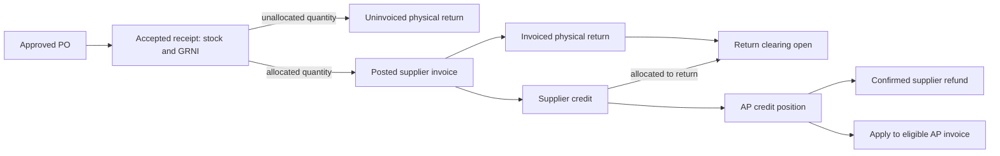
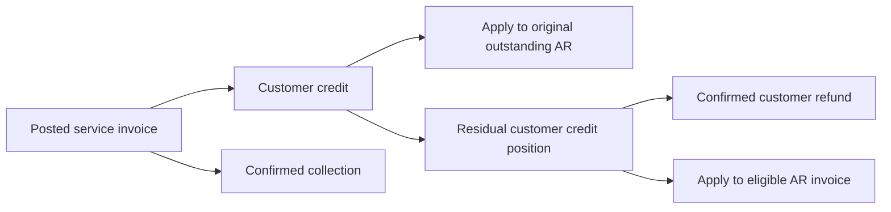

# CF-05: Proposed correction posting contract

**Version:** 0.1, 19 November 2026  
**Status:** Draft; not accountant-approved, not implemented, and not an authority to post. CF-05 remains open.  
**Baseline:** Source 0.2.0 / schema 8; installed versions and migration are unverified.  
**Dependency:** [CF-01](CF01_FINANCE_DECISION_RECORD.md) is open; its jurisdiction, tax, period, valuation and scope decisions govern this proposal.  
**Trace:** [CF-05?09](CORE_FINANCE_EPIC_AND_STORIES.md#cf-05--prepare-a-correction-posting-contract), FUP-03, MOD-FIN-01, FR-FIN-09.

## Decision and review gate

This is a candidate policy for independent Finance calculation and qualified accountant review, not evidence that either occurred. Before implementation, Finance must select the jurisdiction and tax treatment under CF-01, confirm the accounts and treatment below (including tax timing, price-only credits, settlements and separate movement/credit timing), and resolve legal documentation and retention requirements. A Finance owner and qualified accountant must independently calculate fixtures from the assumptions, record their identities, qualifications, date, version, decisions, discrepancies and evidence links here, and approve the matrix and diagrams. Record rejected or changed assumptions and version the contract and fixtures together. No owner, independent calculation or approval has been supplied. CF-06?09 require this gate; no database or deployed capability follows from this draft.

## Scope and terms

INR; money is exact paise, quantities and incoming unit costs up to six decimal places. Original source snapshots, not current master prices or tax rates, determine correction eligibility. Accepted receipt quantities only; rejected/damaged quantities that never entered stock are excluded. A service credit has no stock movement. Supplier credits do not imply physical return or bank receipt; customer credits do not imply payout. No stocked customer returns, non-stock supplier invoices, foreign currency or statutory filing is specified here.

Define **C** as original receipt carrying value allocated to a returned quantity, **V** as current moving-average outgoing stock value, **N** as credit net, **T** as the eligible original input/output tax correction and **G = N + T**. Values are positive unless explicitly shown signed. Proposed 5120 purchase variance handles cost differences and price-only credits. A new, separately reconciled **supplier return clearing** account and subledger are required for invoiced physical returns; its mapping and normal balance require Finance approval. It is not an existing system account. Debit/credit reverses when a signed variance is negative. No zero-value journal line is created.

## Source and state diagrams

Draft ? submitted ? independently approved ? posted; reject/cancel before posting releases reservations; any material revision returns to draft and clears approvals. Posting rechecks all constraints. Posted events are immutable. Movement and credit can occur in either order: a credit may remain unmatched to a physical return, and a return remains in clearing until an eligible credit is linked. Their outstanding quantities and amounts are visible and reconciled; neither event creates the other. If a credit is posted first, its inventory-related original-cost component is credited to return clearing; the subsequent movement debits it. A price-only credit has no return clearing or physical quantity. No automatic write-off of unmatched clearing is allowed.

## Posting matrix

Each event is a separate balanced journal in its own open period. Allocation to an open item is a subledger reclassification within the same control account and posts no additional GL; refunds are distinct events. Inventory is valued per item and warehouse at posting time.

| Event | Debit | Credit | Constraints and reconciliation |
| --- | --- | --- | --- |
| Uninvoiced accepted receipt return | GRNI C; 5120 max(V?C, 0) | Inventory V; 5120 max(C?V, 0) | Consume only unbilled receipt allocation. GRNI residual equals unbilled original receipt value. |
| Invoiced physical supplier return | Return clearing C; 5120 max(V?C, 0) | Inventory V; 5120 max(C?V, 0) | Consume invoiced returnable quantity once; clearing is linked to invoice allocation and later credit. |
| Supplier goods credit linked to physical return, or expected return | AP G; 5120 max(C?N, 0) | Return clearing C; input tax T; 5120 max(N?C, 0) | C is the original receipt value attributed to the credited quantity. Credit can precede movement, leaving a credit clearing balance. |
| Supplier price-only credit | AP G | 5120 N; input tax T | No quantity or stock effect; net/tax must stay within remaining eligible source components. |
| Customer service credit | Sales N; output tax T | AR G | Apply against original outstanding first; residual is a customer credit position, not cash. |
| Confirmed supplier refund | Bank amount | AP amount | Allocate only an available supplier debit/credit-note position; bank receipt evidence required. |
| Confirmed customer refund | AR amount | Bank amount | Allocate only an available customer credit position; bank payout evidence required. |

Tax correction is proposed proportional to the original eligible tax component for the credited net, subject to the original tax snapshot and explicit accountant-approved law and rounding rules. No tax adjustment may exceed the remaining original tax. Nonrecoverable original purchase tax in 5120 is a separate eligible expense component; its correction credits 5120, not input tax. Gross includes that component. A credit cannot invent tax or use a current rate. Tax-only corrections, negative net components and unmatched amounts outside the original source require a separately reviewed contract; reject them here.

## Limits, allocation and evidence

- Maintain independent cumulative quantity and value ledgers per original receipt line, invoice allocation and invoice line. Uninvoiced returns plus posted invoice allocations cannot exceed accepted quantity or original receipt value. Invoiced physical returns cannot exceed invoiced quantity less prior returns; supplier credits cannot exceed remaining original invoice net, recoverable/nonrecoverable tax and gross per line after earlier credits, irrespective of payment. Price-only credits consume value, not physical quantity. Customer credits similarly cannot exceed each original service line's net, tax and gross after previous credits. Reject any combination that exhausts a component even if another remains; do not net unrelated lines to bypass limits.
- Each goods credit quantity can be matched once to a physical return and each returned quantity once to a goods credit. A partial match allocates original C and credit components proportionally from remaining amounts; the final match takes the exact remaining paise. Credit amounts and physical C are tracked separately. Unmatched clearing is a reconciling item by source, age and sign, not a duplicate AP/stock adjustment.
- Apply each new credit first to outstanding original invoice principal, including existing reserved settlements; only unreserved outstanding is available. Residual is an explicit same-party credit open item. Payments/collections already posted remain unchanged. A separate authorised allocation may apply available residual to another posted same-party INR invoice, limited by both unreserved balances; otherwise retain it for refund. No automatic reallocation of prior settlements, cross-party netting or negative invoice balance. A pending reservation reduces availability until rejected, cancelled or expired under the selected policy.
- A refund consumes only unreserved residual credit, never the original gross credit twice. Require same party and INR, positive amount, confirmed external transfer date and bank reference, direction, bank account, evidence reference and allocations. Enforce normalized external reference uniqueness per bank account and direction across confirmed transfers, including payments/collections, subject to a reviewed bank identity policy. Duplicate supplier credit document references are unique per supplier including cancelled drafts; review suspected collisions rather than renumber silently. Preserve reason, source IDs/versions, quantities, tax and price snapshots, evidence, author and approver decisions, dates, journal, movement, allocation and retry links. Evidence references must not contain credentials or unnecessary personal data.
- Posting date must be in an open period, no later than database current date and not earlier than any source event it depends on; refund date must not predate the credit or confirmed external transfer. Record external document/transfer date separately. Prior closed periods remain unchanged; use a permitted current open date and preserve original dates. No backdating into a closed period or automatic reopening. Verify timezone and applicable tax timing in CF-01 before approval.
- Proposed fail-closed policy: inactive or blocked party, item, warehouse, account or approver cannot initiate or approve a new correction, allocation or refund; preserve visibility of history. Reactivation requires an independently authorised master-data process and revalidation, not an override in the transaction. If a legal or operational exception is needed, hold for a separately approved policy; do not bypass blocking.

## Controls and error handling

A permitted preparer submits a versioned document. A different authorised Finance reviewer approves each credit, allocation and refund; a different authorised warehouse reviewer confirms each physical return. No actor approves their own work; approvals bind the evidence, amounts and source versions. Price/tax differences from the original, unmatched clearing, blocked records and unusual dates are exceptions held for independent Finance decision; unsupported tax-only changes and ceiling breaches are rejected, not waived. Refund evidence must show an already confirmed external transfer; approval neither initiates nor proves one. Approval policy, thresholds and roles require CF-01/CF-12 decisions before implementation.

Under the existing company financial lock, lock and re-read sources, stock, open items, reservations, reference uniqueness and versions in a deterministic order. Recompute eligibility and valuation at commit. Source state, allocations, stock movement, balanced journal, clearing, history, audit and successful actor-scoped idempotency response commit atomically. On failure none commits. Same actor/key and identical canonical payload returns the original result; changed payload conflicts. A timeout has unknown outcome: query the original key/source and verify bank evidence before retry, never make a second transfer. Stale versions, insufficient stock, duplicate reference, expired approval and competing consumption fail without fragments. Reconcile source detail to inventory, GRNI, AP, AR, clearing, tax and bank GL at cutoff; unresolved differences block closure.

Correct a posted error through a linked, independently approved compensating event in an open period, reversing its exact posted components and allocations only where dependent settlements/movements are first unwound by their own linked compensating events. Do not delete or edit the original, reopen a closed period, recreate a bank transfer, or assume a reversal is possible when later activity prevents it. Hold for Finance resolution if safe unwind cannot be demonstrated. The exact reversal engine is future work and requires the same locking, evidence and reconciliation controls.

## Synthetic expected-results fixtures ? awaiting independent Finance calculation

All amounts INR; examples are hand-calculated proposals, not test results or independent Finance evidence. Tax is hypothetical at 10%, recoverable, and not a legal assertion. Each scenario begins with zero balances except the stated source events. Debit balances are positive below; credit balances are negative. Journals show Dr / Cr and each event balances.

1. **Uninvoiced partial then final return:** receipt 10 units at 10 = Dr Inventory 100 / Cr GRNI 100. After an unrelated stock increase of 10 units at 20 (Dr Inventory 200 / Cr adjustment 200), stock is 20 units / 300. Return 4 original units: C 40, V 60; Dr GRNI 40 and 5120 20 / Cr Inventory 60. Return remaining 6 when stock is 16 units / 240: C 60, V 90; Dr GRNI 60 and 5120 30 / Cr Inventory 90. Final stock 10 units / 150, GRNI 0, variance debit 50; total debits and credits across the four journals are each 450.
2. **Invoiced return, different price and tax, later settlement:** receipt 10 at 10: Dr Inventory 100 / Cr GRNI 100. Invoice net 120, tax 12: Dr GRNI 100, input tax 12, 5120 20 / Cr AP 132. Pay 80: Dr AP 80 / Cr Bank 80. Return 5 at current value V 50 and original C 50: Dr clearing 50 / Cr Inventory 50. Supplier credit net 60, tax 6: Dr AP 66 / Cr clearing 50, input tax 6, 5120 10. Apply 52 to original AP; residual supplier debit position 14. Receive refund 14: Dr Bank 14 / Cr AP 14. Final inventory 50, GRNI 0, AP 0, input tax 6 debit, 5120 10 debit, clearing 0, bank 66 credit. Total debits and credits each 442. A later additional credit or return beyond remaining source components is rejected. A price-only credit can instead credit 5120 and input tax without movement, subject to the shared ceilings.
3. **Fully collected service invoice and partial credit:** invoice Dr AR 110 / Cr sales 100 and output tax 10; collect Dr Bank 110 / Cr AR 110; credit Dr sales 40 and output tax 4 / Cr AR 44. Residual customer credit is 44; refund 20 gives Dr AR 20 / Cr Bank 20, leaving AR credit 24, bank debit 90, sales credit 60 and output tax credit 6. Total debits and credits each 284. A later 24 refund clears AR, total each 308, bank debit 66. Full 110 credit instead of the partial credit leaves customer credit 110 before refund, and zero net sales and tax.
4. **Rounding and contention:** original line 3 units, C 10.00 and tax 1.00, allocated in three equal quantities: first two receive C 3.33 and tax 0.33 each, final receives C 3.34 and tax 0.34; sums exactly 10.00 and 1.00. If two requests each try to consume the final unit, only one can commit; the other fails after rechecking the remaining ceiling. A stale version, failed approval, insufficient stock, duplicate external reference or exception during commit yields no new movement, allocation, journal or successful retry record. Identical retry after a committed response loss returns that single result; a changed payload conflicts. These are required expected outcomes, not observed test runs.

## Review record and revision history

| Version/date | Change | Review and decision |
| --- | --- | --- |
| 0.1 / 2026-11-19 | Initial candidate matrix, state diagrams, controls and synthetic fixtures. | Finance independent calculations, qualified accountant review, CF-01 decisions and approval **outstanding**. |
