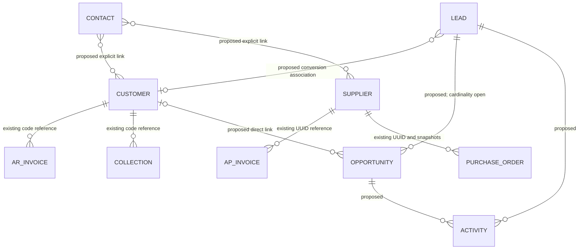

# CRM-01: CRM scope and shared-party decision record

**Prepared:** 20 November 2026  
**Status:** Draft for stakeholder review. No stakeholder decisions or approvals are recorded; CRM-01 and CF-17 remain open.  
**Baseline:** Source application 0.2.0 / schema 8; deployed versions and data are unverified.  
**Trace:** [CRM-01](CRM_EPIC_AND_USER_STORIES.md#crm-01--approve-crm-scope-and-shared-party-rules), [CF-17](CORE_FINANCE_EPIC_AND_STORIES.md#cf-17--design-shared-parties-and-access), [MOD-PLT-01 and MOD-CRM-01](ERP_MODULE_ROADMAP.md#5-candidate-backlog-and-acceptance), [FR-CRM-01/02](SMB_ERP_DESKTOP_PRD.md).

This record translates repository requirements into a **proposed** decision set and synthetic review cases. It is not evidence of stakeholder review, a lawful basis, an implementation, a migration, a deployment or acceptance. Each proposed rule below needs the indicated owners' decision; unresolved decisions block the relevant implementation and release rather than being silently adopted. Existing user instructions are in the [user guide](USER_GUIDE.md).

## Review and decision register

Names and contact details were not supplied in the repository. The roles below identify required reviewers, not appointed people. Record each person's name, decision, date, reviewed revision and evidence link before describing this record as reviewed; record disagreements and their resolution rather than overwriting them.

| Required reviewer | Review responsibility | Person / decision / evidence |
| --- | --- | --- |
| Product owner | Candidate scope, boundaries, priorities and unresolved trade-offs | **Unassigned; open** |
| Sales operations owner | Qualification, owners, stages, reasons, activities and handoff | **Unassigned; open** |
| Customer-data owner / steward | Identity, required fields, duplicates, conversion and data quality | **Unassigned; open** |
| Privacy and security lead | Purpose, lawful basis, retention, access, threat and privacy review | **Unassigned; open** |
| IT / release owner | Compatibility, migration, operations, backup and recovery | **Unassigned; open** |
| Engineering lead | Contracts, invariants, concurrency and implementation feasibility | **Unassigned; open** |
| Finance owner | Existing customer/supplier references, financial history and boundaries | **Unassigned; open** |

| Decision | Candidate for review | Owner and outstanding decision |
| --- | --- | --- |
| Use cases | Capture and qualify leads; maintain contacts and links; manage opportunities and follow-ups; manually review duplicates; link or create a customer; pending/manual Sales handoff; scoped pipeline and privacy workflows. | Product and Sales: select/defer each item and its release boundary. |
| Shared identity | Retain current customer and supplier records and their financial references; explicit reviewed relationships, no automatic merge. | Customer-data, Finance and engineering: approve CF-17 identity and link contract, including any shared-party representation. |
| Data and communications | Collect only fields needed for a documented business purpose. Source is descriptive and does not itself authorise contact. | Privacy and Sales: select each purpose, applicable lawful basis and communication rules for the actual jurisdiction; no basis, consent or contact permission is assumed here. |
| Retention | Apply approved schedules and holds across records, histories, exports and backups; replay restrictions after restore. | Privacy, Finance and IT: select periods, triggers, owners, holds, deletion/minimisation and restore handling for every data class. No duration has been approved. |
| Roles, transitions and release | Use the proposed matrices and cases below as review material. | Product, Sales, customer-data, security and IT: resolve the open questions and record approvals against a versioned candidate. |

## Candidate scope, data and ownership

Candidate release scope is CRM-02–11, CRM-13 and CRM-14 in the [story map](CRM_EPIC_AND_USER_STORIES.md#story-map-and-dependencies), subject to the decisions and dependencies here; CRM-01 is the prerequisite decision work. CRM-12 contact/lead import is **undecided**, not implicitly selected. Selection, scheduling and delivery are open. Out of scope: email/calendar sync, telephony, automated or bulk outreach, external lead capture, mobile/offline operation, campaigns, support, attachments and automatic party merges. A manually recorded activity does not send a message. Quotations, orders, stock, invoices, collections and credit decisions belong to separate Sales/Finance scope; direct existing service invoicing remains available under current permissions.

Proposed domain authority: Platform owns authentication, access and audit controls; customer-data stewardship governs customer identity and approved links; Supply Chain owns supplier masters; CRM owns its leads, opportunities, activities and their links; Finance owns financial records, credit and settlement. Exact authority for shared contacts/addresses, corrections and relationship disputes is **open**. These are business responsibilities, not current system grants.

| Record | Candidate required data at creation / transition | Optional or conditional data and open decisions |
| --- | --- | --- |
| Customer | Existing customer code and name, using current code validation; an authorised creator is required. | No CRM-derived customer field is approved. Authority and any additional minimum data for new-customer conversion are open. |
| Contact / address | Contact: display name and at least one approved, authorised association to a lead, customer or supplier; address: structured value and its permitted association. | Email, phone, title and address components only where purpose and access are approved. Country-specific fields, validation, standalone contacts and shared ownership remain open. Do not require email as identity proof. |
| Lead | Prospect display name, eligible assigned owner and next action; state defaults to New. | Organisation/person distinction, contact details and source are optional candidates; next-action format and whether a lead needs an associated contact are open. Qualification requires the criteria below. |
| Opportunity | Eligible lead or authorised customer link, owner, description and expected close date; stage defaults to Open. | Estimated value is optional; currency/precision, forecast definitions and lead/customer cardinality are open. Value is not revenue. |
| Activity | Authorised lead/opportunity link, eligible assignee, type, due date and state; minimal notes only as needed. | Completion/cancellation reason and business timezone are open. No provider integration. |
| Audit and decisions | Actor, time, prior/new state, record reference and version; reason where a proposed rule requires it. | Event contents, redaction and retention require security/privacy review. All records need stable identifiers and access-scoped history. |

Required fields here are proposed minimums, not approval to collect personal data. Before collection, privacy must document purposes, legal basis, retention/holds, access, discovery, correction, minimisation and backup/export treatment for contacts, addresses, leads, opportunities, activities and audit data. Unnecessary sensitive data and credentials must not be entered in notes or examples.

## Existing identities and proposed relationships

The source defines `erp_customers.code` as the customer primary key (uppercase letters/numbers, hyphen or underscore, maximum 32 characters) and customer name; AR invoices and collections reference that code. Suppliers have a UUID primary key and unique code; purchasing and AP records reference the UUID and some documents snapshot supplier code/name. Items have their own UUID and unique code and are not parties. See [customer and supplier schema](../apps/server/src/database/migrate.ts) and [trade schema](../apps/server/src/database/trade-migration.ts). These are source observations, not a claim about a live database. The repository's CF-17 and MOD-PLT-01 describe required design work; they do not record an approved shared-party model.

Diagram links are conceptual, not schema or a claim that contacts identify a legal entity. A contact may relate to multiple organisations; supplier and customer records may represent the same organisation only through an explicitly authorised, reviewed link. A lead can have at most one durable customer association after conversion; a customer can be associated with multiple leads. Contact/lead and address relationships and opportunity cardinality need further design. No automatic identity merge, deletion or rewriting of financial history is authorised, including on matching email, phone, name or code.

For duplicate review, propose bounded, explainable matching on permitted normalised names and approved contact fields. An authorised steward reviews visible candidates and chooses link existing, create new with recorded rationale, or escalate. Hidden candidates must not leak identifiers, counts or fields; a restricted match routes to an authorised steward without forcing a new record. Recheck candidates at decision time; if data or a candidate changed, require fresh review. Candidate scoring, thresholds, allowed comparisons, evidence and restricted-review procedure remain open. Retain decisions according to the approved privacy schedule; link changes do not merge records.

Proposed conversion: only a Qualified lead with eligible owner, required fields, resolved duplicate review, permission for the selected action and an unrestricted eligible customer can be linked or converted. Existing-customer linking and new-customer creation are distinct grants; missing create authority sends the request to an authorised reviewer. A new customer uses the existing code rules and must not silently confer customer-create authority. Atomically commit the unique lead/customer link, optional authorised customer creation, state/history/audit and idempotent result; conflicting retries, stale versions and competing conversions fail safely or return the original exact-retry result. A match never grants access to financial data. Qualification and conversion do not create opportunities, quotes, invoices, stock movements or journals.

For an eventual migration, preserve every existing customer code, supplier UUID/code, item identity, AR/AP references and historical snapshots. Any proposed shared IDs or links must be additive and reconciled, never inferred as legal equivalence from a matching field. Capture pre/post counts and reference integrity, compare synthetic populated-database invoice/collection and supplier examples, and exercise conflict and rollback/recovery. Version contracts and migration; verify client/server compatibility and reject unsupported combinations. Preserve current access with no silent privilege elevation, review role/session migration, and rehearse protected backup and isolated restore with privacy restrictions replayed. CF-17, CF-12 and IT/security must approve the actual migration and recovery plan; no schema number is reserved and no migration has been performed.

## Proposed permissions and ownership

This is a requirements matrix for review, not an implementation or a mapping to current fixed roles. **Own** means an eligible active assignee's authorised records; **team** means only a separately approved team boundary. All unspecified access is denied. Security must determine field-level grants, team membership and separation of duties before CRM-02 implementation. An owner is an active account explicitly granted the relevant CRM assignment scope; a job title or existing role alone is insufficient. Disabled, restricted or ineligible accounts cannot receive assignments; a manager must arrange an authorised reassignment, with open activities and opportunities handled by explicit decision and audited history. Coverage, team ownership and revocation/session handling remain open.

| Action / data | Representative | Manager | Customer-data steward | Auditor |
| --- | --- | --- | --- | --- |
| Read lead, opportunity, activities and permitted fields/history | Own | Approved team | Only records needed for stewardship | Specifically granted audit scope, read-only |
| Create and edit lead, activity or opportunity; progress stage | Own within granted action | Approved team within granted action | No general grant | Deny |
| Assign / transfer and resolve inactive owners | Deny by default | Approved team, with history | Only if separately granted | Deny |
| Review duplicate candidates / link identity | Only if separately granted | Only if separately granted | Approved candidate and field scope | Read decision history only if granted |
| Convert lead; link existing customer | Separate explicit grants, own scope | Separate explicit grants, team scope | Separate explicit grants | Deny |
| Create customer | Separate customer-create authority; otherwise request review | Same | Same | Deny |
| Reports, searches, history and export | Scoped read; export only by separate grant | Scoped team; export only by separate grant | Stewardship scope; export only by separate grant | Granted audit scope; export only by separate grant |
| Import, privacy action, user/role administration or Finance data | Separate explicitly approved grants only | Separate explicitly approved grants only | Separate explicitly approved grants only | Separate explicitly approved grants only |

Apply checks on the server to list/detail, direct identifiers, related links, fields, search, candidate matches, counts, history, reports, imports and exports. Do not reveal hidden records through errors or aggregates. Test denied direct API requests, changed identifiers, revoked sessions, transfers and field masking, not merely hidden UI controls. Privacy actions, access administration and financial duties require separately reviewed authority and separation of duties.

## Proposed workflow and transition requirements

Every transition checks actor/action and record scope, eligible ownership, current version, required information and restrictions; records actor/time, prior/new state and reason where required. Reject unlisted transitions and stale/conflicting writes; exact retries return the prior result without another event. These states are proposals requiring Product and Sales approval.

| Lead transition | Preconditions / result |
| --- | --- |
| Create → New | Proposed required fields and eligible owner; duplicate candidates are presented within scope. |
| New → Qualified | Owner records that identity and business need are sufficiently understood and a next action exists; exact qualification checklist is **open**. Creates no customer or opportunity. |
| New or Qualified → Disqualified | Authorised actor supplies a reason; preserve history. |
| Disqualified → New | Manager or other explicitly granted actor supplies a reason; recheck ownership/restrictions. Whether reopening is allowed is **open**. |
| Qualified → Converted | Only the reviewed link/create operation above; one durable association. Converted is terminal pending an approved correction policy. |

| Opportunity transition | Preconditions / result |
| --- | --- |
| Create → Open | Eligible qualified lead or authorised existing customer, owner, description and expected close date. |
| Open → Won or Lost | Authorised actor supplies a reason and preserves history. A win is a CRM outcome, not an order or revenue. |
| Won or Lost → Open | Proposed manager-only reopening with reason; whether allowed and treatment of existing handoff are **open**. |
| Cancellation | No cancellation state is selected; Sales must decide whether it is needed and define its reason/history. |

Candidate reason lists for review: win — fit/value, existing relationship, other; loss — price, no fit, timing, competitor, other. Require an explanation for other; these are illustrative, not approved taxonomies. Candidate activity types: task, call, meeting and interaction note; states open, completed or cancelled, with actor/time and authorised reassignment. Source is optional, with candidate values referral, direct enquiry and other; it conveys neither consent nor permission to contact. Sales and privacy must approve lists, changes, sensitive-note restrictions and communication rules.

Proposed Sales handoff requires an authorised actor, an eligible linked customer, an opportunity in an agreed handoff-eligible state and permitted recipient/field scope. The exact state (including whether Won is required), recipient and acknowledgement are **open**. The minimal candidate payload is stable customer code, opportunity reference/description, owner, permitted contact reference and next action, filtered by recipient access. Record sender, receiving responsibility, time, version and pending/manual status; exact retry returns the same handoff reference, while a changed payload or stale version requires a new reviewed action. If quoting is unavailable, retain pending/manual status; no quote action, order, invoice, cash receipt or revenue posting is implied. MOD-SLS-01 must separately approve an integration contract.

## Synthetic review cases and expected outcomes

These are invented inputs and proposed expected results, not executed tests or stakeholder sign-off. Names, codes and actors are illustrative; no contact details are real. All actions assume the above draft permissions and policy have been approved and implemented.

| Case | Input / action | Proposed expected result |
| --- | --- | --- |
| New lead | Representative A, eligible for Team A, creates `LEAD-EX1`, “Example Prospect”, owner A and next action “review requirements”; no source. | New lead remains assigned to A; source is blank. Qualification requires the eventual approved checklist; neither creation nor qualification creates a customer or opportunity. |
| Existing customer | Qualified `LEAD-EX2` matches authorised customer `CUST-EX1`; steward confirms identity, and an actor with link and conversion grants selects it. | One association to `CUST-EX1`, state Converted and decision history; customer code and pre-existing invoice/collection references remain unchanged. Repeating the same request returns the same result. No journal is created. |
| Duplicate candidates | Two distinct organisations, `CUST-EX2` and `CUST-EX3`, share a contact field; another candidate is restricted from A. | Matching proposes review, never automatic merge. A sees only permitted information; a safe escalation reaches a steward for the restricted possibility. Steward records link, justified create-new or escalation; stale candidate review is repeated. No protected identity or hidden count is exposed. |
| Won and lost | Owner A marks eligible `OPP-EX1` Won with candidate reason “fit/value”; marks `OPP-EX2` Lost with “timing”. | Each has a distinct transition and reason/history; neither creates a sale, invoice or journal. Handoff is available only when its still-open eligibility and permissions are approved; reopening follows an approved policy. |
| Denied access | Representative B, assigned only to Team B, requests A's lead directly by identifier and tries to export its history or convert it. | Server denies every operation without returning record fields, related identity or restricted counts; no association, transition or audit disclosure occurs. An authorised security audit may record the denial without exposing personal data. |
| Conversion conflict | Two authorised actors try to create different customers for the same qualified lead concurrently; another retries the successful request after losing its response. | At most one association and customer creation commit; the losing conflicting request fails safely, and an exact retry returns the original result. No partial customer or financial side effect remains. |

## Release dependencies and review exit

Before selecting or releasing a candidate, obtain named reviewer decisions on all open items above; reviewed CF-17/MOD-PLT-01 shared identity, CF-12 access/SoD and CF-14/15 privacy dependencies; and the applicable phase 1 gates and findings. Select or defer CRM-12 with import format, privacy and duplicate policy; approve report definitions and Sales handoff independently. Validate implementation with allowed/denied API and UI cases, state/history and concurrency/idempotency tests, scoped reports/exports, synthetic data, accessibility and representative workload. Rehearse populated upgrade and isolated restore, reconcile identities/references and verify no CRM event creates stock or GL effects. Record actual versions, environment, defects, backup/recovery and named product, Sales, privacy/security, Finance and IT release decisions under [CRM-14](CRM_EPIC_AND_USER_STORIES.md#crm-14--release-and-recover-the-crm-increment). Missing evidence holds the relevant gate. Neither this draft nor a future review of it alone accepts phase 1 or CRM.
