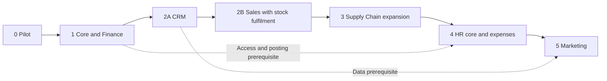

# ERP module expansion roadmap

**Reviewed:** 17 November 2026  
**Status:** Proposed product plan; implementation, estimates and release acceptance remain separate work  
**Source baseline:** Application 0.2.0 / schema 7; deployed versions and acceptance are unverified  
**Planning assumptions:** Windows desktop, one company per deployment, INR, shared on-premises server; current pilot capacity remains one developer for two weeks

## 1. Direction and boundaries

Expand the ERP into six connected business areas: **Finance, Sales, CRM, Supply Chain, HR and Marketing**. Finance and Supply Chain extend existing foundations; Sales extends customer billing into order fulfilment; CRM, HR and Marketing add new domains. Use ERPNext as a workflow reference, with the [current reference crosswalk](ERPNEXT_MODULE_CROSSWALK.md) recording sources and differences.

Retain Electron/React/TypeScript, NestJS/TypeScript and PostgreSQL. The proposed implementation is a modular application server with shared contracts and one transactional database. This plan does not adopt Frappe, install ERPNext, copy its code or provide an ERPNext connector. Any future reuse or integration needs its own compatibility, licence and operational review.

The [controlled pilot](NEXT_SPRINT_PLAN.md) remains the immediate ten-working-day plan. The phases below are dependency order, not calendar promises or an expansion of that sprint. Production readiness remains a gate for the selected release scope; listing later modules does not make every future feature a prerequisite for the core release.

## 2. Current capability and proposed scope

Implemented means present in source, not deployed, migrated or accepted at a customer. [User guide](USER_GUIDE.md), workflow guides, contracts and migrations establish the current behaviour.

| Module | Implemented foundation | First planned increment | Deferred scope |
| --- | --- | --- | --- |
| Finance | INR books, accounts/periods, manual journals/reversal, AP/AR, dual-approved supplier payment recording, collections, configured tax, entered bank statements and financial statements. | Linked supplier/customer credits and refunds; opening migration; controlled reports/exports; reviewed close and accounting configuration. Then cost centres, budgets and bank-file matching. | Foreign currency, fixed assets, statutory filings and multi-company consolidation need separate decisions. |
| CRM | Customer register only; no lead, opportunity, contact or activity workflow. | Shared contacts/addresses, leads, qualification, assigned activities, opportunities/stages, deduplication and conversion to an existing or new customer. | Telephony, email synchronisation, support tickets and a separate CRM product/connector. |
| Sales | Customer service/non-stock invoices, AR and confirmed collections; no stocked sales or COGS. | Quotations, approved prices/discounts and credit checks, sales orders, reservations, partial dispatch, linked invoices, returns and collections reconciliation. | POS, ecommerce, subscriptions, commissions and drop shipping. |
| Supply Chain | Supplier/item masters, requests/approval, one order per request, partial/damaged receipt evidence, matching, warehouses, transfers and weighted stock. | Reorder recommendations, RFQs/supplier quotes, controlled order sourcing, supplier returns, counts/adjustment approval, quarantine/release and delivery picking. | Batch/serial/expiry, landed costs and logistics/provider integrations follow specific business demand; manufacturing/MRP is separate. |
| HR | User accounts for access control; these are not employee records. | Departments/designations, employee lifecycle, optional account links, leave policies/balances/approval, basic attendance and expense claims integrated to Finance. | Recruitment, performance, biometrics and payroll; payroll requires jurisdiction-specific specification and validation. |
| Marketing | No campaign, audience, consent/preference or outbound delivery workflow. | Campaign plans, source attribution, audience definitions, communication eligibility/suppression and aggregate funnel/cost reporting using CRM/Sales. Start with planning and manual campaign results. | Automated email/SMS/social/ad delivery, tracking pixels and marketing automation require provider and privacy/operations decisions. |

## 3. Shared ownership and module boundaries

| Owner | Authoritative records | Cross-module contract |
| --- | --- | --- |
| Platform | Authentication, permissions, configuration, versioned approvals, audit, imports/privacy infrastructure and integration delivery. | Every module declares action/record/field/export scopes, immutable identities and documented events. Current fixed roles do not grant future-module access. |
| CRM / shared parties | Contacts/addresses, leads, opportunities and governed links to customer identities. | Reuse current customer codes; do not create a second customer ledger or automatically merge legal identities. Finance owns credit and settlement fields. |
| Sales | Quotations, order commitments, pricing snapshots and fulfilment instructions. | Reference CRM parties and shared items; request reservations/dispatch from Supply Chain; request invoice posting from Finance. |
| Supply Chain | Suppliers/items/warehouses, purchasing, reservations, movements and valuation. | One stock ledger; dispatch and returns link to Sales lines; all valued movements use the existing controlled posting boundary. |
| Finance | Chart/periods, tax/accounting policy, journals, subledgers, invoices, credits and settlement. | One general ledger; other modules supply approved source records rather than writing journal tables directly. |
| HR | Employee records, manager relationships, leave/attendance and claims. | Employee identity is distinct from login identity; approved claims create a separately specified employee payable, not a fabricated supplier invoice. |
| Marketing | Campaigns, membership snapshots, preferences/suppressions and attribution. | Reference CRM contacts; Finance owns actual expense postings and Sales owns realised revenue. A prospect or campaign does not create revenue. |

Contacts can relate to several organisations. Deduplication suggests candidates for authorised review; it never merges customer/supplier financial identities merely because an email matches. Employee details and marketing preferences must not flow into general party search or global dashboards by default.

## 4. Delivery sequence and gates

Phase numbers describe this roadmap. Requirement priorities P0/P1/P2 in the PRD describe importance to a release and are not phase numbers. Previous broad delivery phases are refined by this plan.

| Phase | Outcome / candidate epics | Dependencies | Exit evidence |
| --- | --- | --- | --- |
| 0 — Controlled pilot | Existing PIL-01–08: compatibility, protected staging, recovery, access/financial/privacy review, accessibility, workload and signed handover. | Named reviewers, staging infrastructure and existing two-week capacity. | Recorded pilot acceptance; no inferred production approval. |
| 1 — Core and Finance completion | Existing FUP-01–08; MOD-FIN-01/02; shared party and access design MOD-PLT-01. Close account recovery, correction/opening, privacy, configurable policy and operational gaps for the selected core release. | Pilot findings; finance/privacy/IT ownership and initial jurisdiction decision before production. | Source-to-ledger correction/opening reconciliation, denied-access checks, recoverable migration and selected release's production gates. |
| 2A — CRM foundation | MOD-CRM-01: contacts, leads, opportunities and conversion. | Reviewed party identifiers, record scopes, import/privacy coverage. | Duplicate-safe conversion, assigned pipeline and activities, scoped exports and no accounting effects. |
| 2B — Sales and revenue | MOD-SLS-01/02: quote/order, basic reservations, dispatch, invoice, return and collection. | Phase 1 correction rules, phase 2A party handoff, existing stock valuation and a jointly delivered Supply Chain reservation/dispatch slice. | Partial order-to-cash and returns reconcile stock, COGS, AR, tax and bank exactly once. |
| 3 — Supply Chain expansion | MOD-SCM-01/02: replenishment, sourcing, returns, quality/count control; extend basic fulfilment. | Phase 1 credits; phase 2 stock commitment rules; reviewed procurement/warehouse policy. | Demand-to-order traceability, approval-controlled sourcing and stock/GRNI/AP/GL reconciliation including damaged/returned stock. |
| 4 — HR core and expenses | MOD-HR-01/02: employees, leave, attendance and claims. | Phase 1 access/privacy framework, employee payable/posting rules and secure attachment decision. | Own/manager/HR boundaries; leave balance concurrency; independently approved claims reconciled to Finance and confirmed payment. |
| 5 — Marketing and attribution | MOD-MKT-01/02: planning, eligibility, source tracking and measurable results; optional delivery after separate gate. | Phase 2 CRM/Sales; preference/retention model, approved attribution definitions and Finance cost linkage. | Suppression and access checks, reproducible funnel/cost metrics; delivery only with approved provider/retry/restore controls. |
| Later — Conditional extensions | Jurisdiction-specific payroll, manufacturing/MRP, projects, assets, support, POS/portals, integrations and multi-company. | Separate business case, domain design, staffing and regulatory/operating decisions. | Module-specific release scope and evidence; no automatic commitment through this roadmap. |

The solid path is the proposed delivery order for limited capacity, not a technical requirement that HR depend on all Supply Chain features or Marketing on all HR features. Reordering needs an updated plan and estimates. Discovery may refine a later module while the accepted implementation remains focused on the current phase.

## 5. Candidate backlog and acceptance

These stories are proposed, unestimated and outside PIL-01–08. FUP items remain open until their own evidence is accepted. Detailed contracts, UI designs and test fixtures are required before scheduling an implementation story. The [Core and Finance epic and stories](CORE_FINANCE_EPIC_AND_STORIES.md) refine phase 1, FUP-01–08 and MOD-PLT-01/MOD-FIN-01/02 into traceable candidate work; they do not add scope to the current pilot.

| ID / accountable function to name | User outcome | Minimum acceptance |
| --- | --- | --- |
| MOD-PLT-01 / Product + engineering | Share identities and controls across modules. | Preserve customer codes and supplier/item identities; specify optional contact/employee links; version contracts, permissions and module release manifest; deny ungranted reads, searches, reports and exports. |
| MOD-FIN-01 / Finance | Correct and migrate books safely. | Refine FUP-03/04: linked partial credits/returns/refunds bounded by original quantities/values and prior settlements; balanced openings; periods, tax/rounding, retries and concurrency; AP/AR/GRNI/stock/GL tie-out. |
| MOD-FIN-02 / Finance | Control spending and close with reproducible reports. | Refine FUP-05/07: reviewed cost-centre/budget definitions, policy versions, report/export grants and bank-file format/duplicate detection; selected close checks and statement totals agree with posted sources. |
| MOD-CRM-01 / Sales operations | Qualify prospects and hand them to Sales without duplicate entry. | New → qualified → converted/disqualified lead; opportunity won/lost with reasons and stage history; assigned follow-ups; retry-safe customer linking/conversion, protected contact imports and correct pipeline counts. Conversion is not a sale or ledger posting. |
| MOD-SLS-01 / Sales + Finance | Agree and control customer commitments. | Draft → reviewed/approved → accepted/closed quote/order states specified; exact price/tax snapshots, discount authority, credit hold and reassessment; preserve original accepted version and partial outstanding quantities. Quotes/orders create no journal. |
| MOD-SLS-02 / Warehouse + Finance | Deliver, bill and correct stocked sales. | Refine FUP-09: locked/versioned reservations, release on cancellation, partial picking/dispatch, no oversell under concurrency; dispatch/COGS once, invoice/AR once, returned stock and credit/refund links; service AR retains its no-stock path. |
| MOD-SCM-01 / Purchasing | Turn shortages into controlled sourcing. | On-hand/reserved/inbound/demand quantities have defined meanings; reorder suggestions require review; comparable supplier quotes and approved order changes; prevent ordering the same demand twice; a suggestion/RFQ has no journal. |
| MOD-SCM-02 / Warehouse + Finance | Control stock exceptions and supplier returns. | Quarantine/release/disposal states, independent count adjustment and receipt-return limits; review valuation/GRNI/AP/tax variance for invoiced versus uninvoiced returns; no mutation of original movements or invented purchase receipts. |
| MOD-HR-01 / HR | Maintain employees and approve leave/attendance. | Employee lifecycle is separate from login; offboarding triggers an explicit authorised access review; own/manager/HR field rules; leave allocations, overlaps, cancellation and concurrent approvals preserve balances; no payroll calculation. |
| MOD-HR-02 / HR + Finance | Reimburse independently approved expenses. | Submitted → approved/rejected → posted → settled claim; no self-approval, employee payable mapping, expense/tax review, controlled correction and unique confirmed-payment reference; no payroll or automatic money transfer. |
| MOD-MKT-01 / Marketing + privacy | Plan campaigns and measure acquisition. | Draft/reviewed/active/completed campaign with owner/budget/dates; purpose/channel preferences and suppressions; eligible audience snapshot; source links through lead/opportunity/order/invoice; fixed attribution window/model, deduplicated conversions, costs reconciled to Finance. |
| MOD-MKT-02 / Marketing + operations | Deliver approved communications reliably if selected. | Separately approve provider/network/data handling; recheck suppression at dispatch; signed callbacks, deduplication and bounded retry/dead-letter handling; restart/restore cannot blindly resend; honour unsubscribe and expiry. No outbound delivery in the initial planning increment. |

## 6. Workflow and accounting contracts

The intended customer journey is campaign/source → lead/contact → opportunity → quotation → sales order → reservation/pick/dispatch → invoice → confirmed collection. Existing direct service AR remains supported. CRM/Marketing attribution refers to the chain but never duplicates customer balances or treats pipeline value as posted revenue.

The supply journey is reviewed replenishment/demand → request → RFQ/quote selection where needed → approved order → receipt/quality decision → matched invoice → approved recorded payment. The current one-request/one-order constraint remains until a reviewed allocation migration implements split/consolidated sourcing.

The people journey is employee setup → leave/attendance or expense request → independent approval → Finance posting/settlement for claims. Payroll is a separate gate after country, salary/tax/benefit rules, sensitive-data access and legal/accounting validation are specified.

Before implementation, extend [accounting postings](ACCOUNTING_POSTINGS.md) and [trade posting rules](TRADE_POSTING_RULES.md) with reviewed events. Proposed defaults are dispatch Dr COGS / Cr Inventory, invoice Dr AR / Cr Revenue and applicable output tax, collection Dr Bank / Cr AR. Returns/credits/refunds must define original-cost versus current-cost variance, tax reversal, remaining allocation and period treatment. Employee claims need their own payable control and settlement contract. These are proposed contracts, not executable posting rules or permission to use manual control-account journals.

## 7. Architecture, data and security work

- Introduce cohesive CRM, Sales, HR and Marketing domains and extend existing Finance/procurement/inventory domains. Follow the current repository structure; new names are proposed until code exists. Keep shared contracts and typed IPC, server validation and bounded permission-scoped lists.
- Preserve one stock ledger, one GL and existing source/audit/history/idempotency atomicity. Reservations do not reduce physical on-hand; dispatch consumes both eligible stock and commitments. Define lock order and measure contention before changing the existing company financial lock.
- Add migrations after schema 7 only when reviewed; do not allocate a fictional future schema version. Backfill identifiers without breaking current customer codes or posted references. Rehearse upgrades with old data, compatibility rejection and new-database recovery.
- Define separate business, record, field and export permissions for sales teams, warehouse locations, employees/managers/HR and Marketing. Current accounts have one fixed role; configurable/composable access requires a deliberate migration and separation-of-duties review.
- Extend the personal-data inventory, case discovery/exports, legal holds, retention and restore replay to contacts, employee records, attachments, activities and campaign audiences. The current privacy tool does not cover these future entities. Apply suppression and privacy actions before restarting integrations after recovery.
- Attachments, schedulers, mail/SMS providers, webhook ingress and background delivery require explicit storage, credentials, network routes, size/type checks, retry, monitoring and backup ownership. A transactional outbox is a proposed option, not an installed service. Normal desktop operation continues to require server connectivity.

Detailed proposed entities and invariants belong in [backend schema](SMB_ERP_BACKEND_SCHEMA.md); enforcement and delivery requirements belong in [technical requirements](SMB_ERP_TECHNICAL_REQUIREMENTS.md) and [security/access](SMB_ERP_SECURITY_AND_ACCESS.md).

## 8. Module release acceptance and operations

Each module release needs a named business owner, an agreed scope and dataset, independent expected results, passing allowed/denied permission checks, state/retry/concurrency tests, source reconciliation, keyboard/screen-reader review and measured performance for the changed workload. Current customer load tests and past pilot results cannot establish module capacity.

Release records identify client/server/contracts/schema and included modules, migration/backfill outcome, dependency findings, signed artifact, unresolved defects, deployment decision and rollback authority. Use existing [deployment](DEPLOYMENT.md), [testing runbook](SMB_ERP_TESTING_DEPLOYMENT_RUNBOOK.md), [operations](OPERATIONS_RUNBOOK.md) and [recovery](BACKUP_RESTORE.md) procedures. Capture actual evidence; no module flags, installer bundles or independent module installation commands are introduced by this plan.

Before enabling jobs or attachments, prove backup coverage and isolated restore, invalidate restored sessions and replay restrictions/suppressions. Keep outbound delivery paused until reconciled delivery records and recipients are reviewed. Do not start a payroll or campaign job merely because a restored server is healthy.

## 9. Sizing, ownership and decisions

The known capacity covers only the existing pilot. Do not extrapolate its eight developer days to six modules. Before committing any later phase, break the candidate epics into vertical slices, estimate implementation/migration/UI/testing/docs together, identify external reviewer and infrastructure lead times, reserve defect capacity and publish a milestone plan. No calendar or cost commitment is made here.

| Decision | Accountable function to name | Required before |
| --- | --- | --- |
| Pilot findings, first expansion priority and available staffing | Product / business sponsor | Scheduling phase 1 and revising phase order. |
| Country, accounting/tax/retention scope and Finance acceptance | Finance / accounting / privacy | Production core acceptance; separately before payroll or country packs. INR remains the current currency. |
| Customer/contact ownership, credit/discount policy, team scopes and stocked/service sales cases | Sales / Finance | CRM/Sales schema and permission approval. |
| Demand, reservation, sourcing, warehouse/quality and return policy | Purchasing / warehouse / Finance | Sales stock slice and Supply Chain design. |
| Employee fields, manager scope, leave/attendance rules and claim payment policy | HR / privacy / Finance | HR implementation; payroll remains separate. |
| Marketing purposes, audience eligibility, attribution and provider choice | Marketing / privacy / IT | Audience collection; separate approval before outbound delivery. |
| Attachment storage, integration/job operation, backup sizing and support ownership | Engineering / customer IT | Adding any new operational dependency. |

Planning may use synthetic cases immediately. Customer acceptance, reviewer assignments and production configuration remain explicit future decisions, not presumed approvals from this document.

## 10. Documentation coverage and review history

The [documentation index](README.md) maps current instructions and planning documents. This roadmap owns phase order and candidate epic IDs; the PRD owns product requirements; specialist documents own their design/operating implications. The next-sprint files own the immediate pilot budget. Files under `archive/` remain historical and are not revived as a current capability map.

| Date | Revision | Review |
| --- | --- | --- |
| 2026-11-17 | Initial six-module plan | Reviewed source/workflow baseline and official ERPNext/Frappe references. Added proposed scope, dependencies, acceptance and document reconciliation. No application change, migration, deployment or test acceptance claimed. |
| 2026-11-17 | Core and Finance story refinement | Linked the proposed phase 1 epic and CF-01–21 backlog, preserving pilot capacity and existing FUP/MOD traceability. Scope, estimates and release decisions remain open. |
