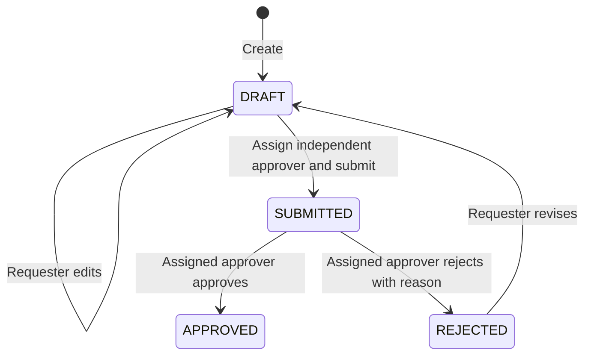

# Suppliers, items and purchase requests

## Activate the update

Stop the old desktop/server, back up the database using the approved procedure, then run from the project root:

```powershell
npm run db:migrate
npm start
```

Migration **4** adds supplier/item masters, request headers/lines, immutable history, procurement retry records and new role values. It preserves existing customers, users and MFA configuration. Update client and server together; the new server requires schema version 4. The code change alone does not migrate the main database.

## Roles

Provision users through **Account security and access**. Every account must complete MFA.

| Role | Purchasing access |
| --- | --- |
| `admin` | Maintain masters/history, create requests, read all requests. No approval permission. |
| `purchasing` | Maintain masters/history, create requests, read all requests. No approval permission. |
| `requester` | Read master selection data; create/revise/submit/read own requests and history. |
| `business_approver` | Create own requests; read own/assigned requests and decide assigned submissions from other users. |
| `auditor` | Read masters/history and all requests/history; no mutations. |
| `reader` / `identity_admin` | Existing customer/identity access; no purchasing access by default. |

Supplier contact email/phone are returned only to users with master-history access: administrator, purchasing and auditor. Requesters/approvers receive the supplier selection fields without contacts. Supplier bank details are not collected in this release.

## Desktop walkthrough

1. As administrator or purchasing user, open **Purchasing → Suppliers**. Create a supplier with a unique code and name, optional contact details and payment terms. Edit/deactivate it from the register. Codes remain fixed.
2. Open **Items** and create an item with code, name, unit and optional description. Items may be edited/deactivated; codes remain fixed.
3. Provision a separate active `business_approver`. Requester and approver must be different accounts.
4. Open **Purchase requests → New purchase request**. Enter title, justification, a three-letter currency code and item lines. Preferred supplier and needed-by date are optional. Search master data if the needed option is not in the first 20 matches.
5. Enter decimal quantities and estimated unit prices; select **Save draft** and review the server-calculated total.
6. Select an independent approver and **Submit for approval**. Submitted requests cannot be edited.
7. The assigned approver signs in, opens the request and reviews the saved version. Select **Approve request**, or enter a reason and **Reject request**.
8. The requester can revise a rejected request. Saving creates a new draft and clears the current assignment/decision from the live header; the earlier rejection remains in history. Select an approver and submit again.

Registers provide search, pagination and filters. Master records have a **History** action for authorised roles. Request details show the latest 200 history versions with expandable snapshots; the database retains all versions until an approved retention process is added.

## States and controls



Only the requester may edit/submit their own draft or revise a rejected request. Approved records have no edit/reopen action. Self-assignment and self-approval/rejection are refused, including for an approver's own requests. The server checks action permissions, record scope, state and expected version.

Requesters/approvers can read their own or currently assigned records. Administrator, purchasing and auditor have explicit broader read access. Submission requires active masters whose versions still match the draft; revise/save after a master change to capture current details. Approval uses the submitted snapshots and verifies referenced masters remain active. Later name/unit changes do not rewrite a submission; rejection remains possible for inactive references.

A disabled/demoted approver cannot decide requests. Withdrawal, reassignment, delegation and threshold policies are later workflow work; resolve unavailable approvers through the approved administration process.

## Validation and exact arithmetic

- Codes contain 1–32 letters/numbers/hyphens/underscores, normalised to uppercase. Names are limited to 160 characters. Supplier contacts are validated; terms are whole days from 0–365. Item units have up to 16 supported letters/numbers/punctuation. Unknown input fields are rejected.
- A request contains 1–100 unique item lines. Quantity is a positive decimal string with at most nine whole digits and six decimal places. Estimated unit price is a nonnegative decimal string with at most ten whole digits and four decimal places. Use a decimal point and a leading zero (`0.5`).
- Totals use PostgreSQL exact numeric arithmetic and are returned as decimal strings, without binary floating-point calculation. Currency is explicitly entered as three letters; no country pack or currency conversion is implied.
- These are pre-tax estimates. Budget checks, tax rounding, purchase orders, stock and ledger posting require the later agreed accounting/procurement scope.

## History, concurrency and retries

Each successful creation, edit, submission, revision or decision increments the version and commits a full history snapshot, audit event and retry result in one transaction. A failure rolls back the event. History rejects ordinary modification/deletion, but database owners can bypass triggers; use appropriate production privileges.

Mutations require expected versions where applicable. The server locks records and related references. Stale edits or competing decisions return `409`; refresh and review the current version before deliberately making a new change. Submission also checks the draft's recorded master versions.

Every procurement mutation requires a UUID `Idempotency-Key`, bound to actor, operation/target and validated payload. Concurrent/later retries return the original successful response without another history entry. Reuse for different data or a different procurement operation returns `409`. Failed transactions do not consume a key. Successful retry records are retained indefinitely until an approved retention/reconciliation process is defined.

The desktop retains a key for an unchanged pending action while the purchasing workspace stays open. After an uncertain save, check the register or retry unchanged. Pending keys are not persisted across reload, workspace closure or sign-out; do not assume a lost response means the write failed. Refresh after a successful retry to see any later versions.

## API

All routes are under `/api/v1/procurement`, require a fully authenticated MFA session and enforce permissions/scope.

| Route | Purpose |
| --- | --- |
| `GET /suppliers`, `GET /items` | Master registers with `page`, `search`, `activeOnly`. |
| `POST /suppliers`, `POST /items` | Create with retry protection. |
| `PATCH /suppliers/:id`, `PATCH /items/:id` | Versioned edit/active-state change; codes immutable. |
| `GET /approvers` | Active business approvers excluding the requester. |
| `GET /requests`, `GET /requests/:id` | Scoped register/detail; register supports `page`, `search`, `status`. |
| `POST /requests` | Create draft and validated lines. |
| `PATCH /requests/:id` | Revise own draft/rejected request with expected version. |
| `POST /requests/:id/submit` | Expected version and independent `approverId`. |
| `POST /requests/:id/decide` | Expected version, decision and rejection reason where required. |
| `GET /history/:kind/:id` | Authorised supplier/item/request history. |

Contracts and validation are in `packages/contracts/src/procurement.ts`. Record IDs are UUIDs. Display numbers are sequence-generated `PR-...` values and may have gaps after rollback.

## Verification

`npm run test:integration` covers validation/redaction, scopes, competing changes, duplicate retries, self-approval restrictions, both decisions, revision, exact totals, stale/inactive references and rollback on history failure. `npm run test:desktop` exercises masters and independent rejection → revision → approval across actual Electron clients. Tests use disposable databases; see [test prerequisites](AUTHENTICATION.md#verification).
