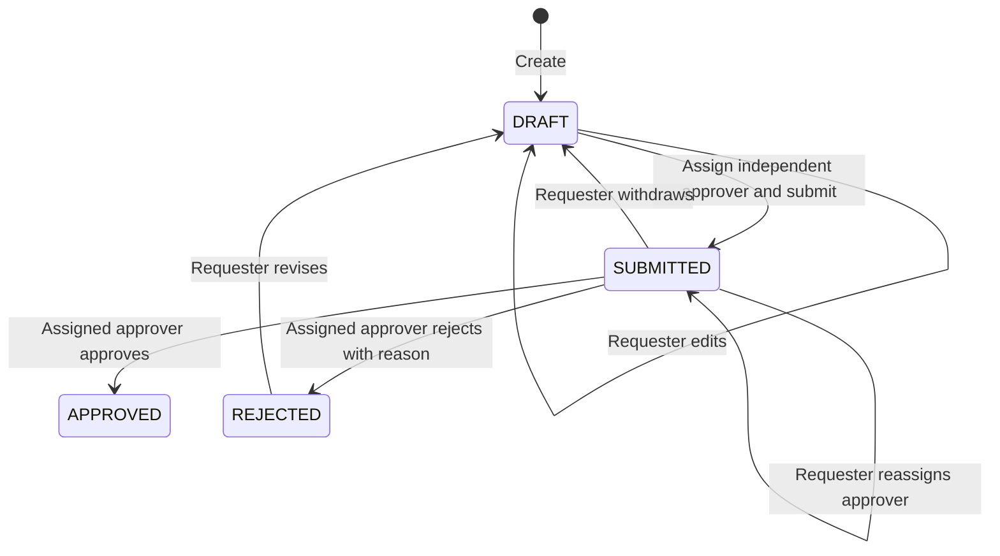

# Suppliers, items and purchase requests

## Historical approval cycles

Supplier renewal follow-up is available in **Suppliers → Qualification status → Approved — expires within 30 days → Apply supplier filters** to existing master-history roles. The query selects current approved records whose validity end is between database current date and current date plus 30 inclusive. It runs before count/pagination and combines with search, contact completeness and active-only. Expired and non-approved records are excluded; no-record and rejected/pending queues remain separate. Refresh is required to reflect current dates/data. Qualification submission and independent review retain their existing eligibility effects, so renewal must account for the pending-review order gate. No schema change or automatic notification.

**Approver holding times** shares `requests.read.all` access. It orders retained submission, reassignment, handoff, approval, rejection and withdrawal history by request/version. An assignment-start event is paired with its next lifecycle event; completed intervals are selected by inclusive UTC end date and paged newest end first. Rows show the start snapshot's assigned-approver email, start/end timestamps, end event and elapsed hours rounded to two decimals. Open intervals are excluded and remain in the current workload view. Earlier approvers retain their own intervals after handoff; retries produce no extra histories. Elapsed time includes weekends and non-working time and is not an SLA assessment. No schema migration; deploy matching client/server.

**Purchase requests → Historical approval cycles** is paged and requires `requests.read.all`. It reads immutable purchase-request approval/rejection history using snapshotted submission/decision timestamps and final-approver email. Inclusive dates filter the decision timestamp in UTC; rows sort newest decision first with history ID as tie-breaker. Earlier rejected cycles remain after later revision/approval. Retry-safe decisions count once. Pending and withdrawn cycles without decisions are excluded. Elapsed hours cover the whole submission cycle including handoffs/weekends, rather than individual approver holding time. Matching client/server update only; no schema migration. Current workload reporting retains its latest-cycle definition.

## Activate the update

Stop the old desktop/server, back up the database using the approved procedure, then run from the project root:

```powershell
npm run db:migrate
npm start
```

Migration **4** adds supplier/item masters, request headers/lines, immutable history, procurement retry records and new role values. It preserves existing customers, users and MFA configuration. Update client and server together; the current server requires schema version 16 (see the [operations runbook](OPERATIONS_RUNBOOK.md)). See [orders and invoice workflows](TRADE_WORKFLOWS.md) for the implemented downstream processes. The code change alone does not migrate the main database.

## Roles

Provision users through **Account security and access**. Every account must complete MFA.

| Role | Purchasing access |
| --- | --- |
| `admin` | Maintain masters/history, create requests, read all requests. No approval permission. |
| `purchasing` | Maintain masters/history, create requests, read all requests. No approval permission. |
| `requester` | Read master selection data; create/revise/submit/read own requests and history. |
| `business_approver` | Create own requests; read own/assigned requests and decide assigned submissions from other users. |
| `auditor` | Read masters/history and all requests/history; no mutations. |
| `reader` / `identity_admin` | Existing customer/identity access; no purchasing access by default. |

Supplier contact email/phone are returned only to users with master-history access: administrator, purchasing and auditor. Requesters/approvers receive the supplier selection fields without contacts. Supplier bank details are not collected in this release.

When a master manager saves a supplier in the desktop, the client checks names ignoring case and repeated spaces, emails ignoring case, and phone digits ignoring formatting (at least seven digits), including inactive records and excluding the record being edited. It shows the count and up to 20 codes/names/statuses. The user corrects the details or records a 3–100-character **Duplicate review reference** and selects **Save with review reference**. Editing a checked field clears the reference. Direct API saves and JSON import commits use the same server check under a transaction lock; competing application saves are serialized. Identity edits and reactivation are reviewed, while an unrelated edit to an already duplicated supplier does not require another reference. A deliberate override retains the reference, matching codes and count in supplier history/audit. It is not a legal-identity check, fuzzy match, automatic merge or database constraint against privileged writes. Shared contacts can match. Use a review ticket, never bank or identity data, as the reference.

The supplier register's **Supplier contact completeness** filter finds records missing either email or phone, or missing both. Select **Apply supplier filters**; search, active-only selection and pagination still apply. Inactive suppliers are included unless **Active only** is selected. The filter requires `masters.history`; it checks for blank fields only, not whether contact details are valid or verified.

An administrator can create a service item with an active non-control expense account in **Items**. The item type is fixed after creation; service items cannot be created by import. Requests and orders snapshot the type and expense account, and order issuance checks that the master still matches the approved snapshot. Service acceptance and invoice posting use the workflow described in [trade workflows](TRADE_WORKFLOWS.md); Finance must review its expense-at-acceptance treatment before production use.

## Desktop walkthrough

The Purchasing **Overview** presents request counts, workflow shortcuts and links to master data. Select **Purchase requests** for the register. The **From request to payment** guide links to the order, receipt, supplier invoice and payment sections available to the signed-in role. On the register it is hidden while a request or draft is open; close the request or save/cancel the draft first. The links navigate only, without selecting a record or transferring unsaved data. Accounts that can read masters but not requests open Purchasing on Suppliers.

1. As administrator or purchasing user, open **Purchasing → Suppliers**. Create a supplier with a unique code and name, optional contact details and payment terms. Edit/deactivate it from the register. Codes remain fixed.
2. Open **Items** and create an item with code, name, unit and optional description. Items may be edited/deactivated; codes remain fixed.
3. Provision a separate active `business_approver`. Requester and approver must be different accounts.
4. Open **Purchase requests → New purchase request**. Enter title, justification, a three-letter currency code and item lines. Preferred supplier and needed-by date are optional. Search master data if the needed option is not in the first 20 matches.
5. Enter decimal quantities and estimated unit prices; select **Save draft** and review the server-calculated total.
6. Select an independent approver and **Submit for approval**. Submitted requests cannot be edited.
7. The assigned approver signs in, opens the request and reviews the saved version. Select **Approve request**, or enter a reason and **Reject request**.
8. The requester can revise a rejected request. Saving creates a new draft and clears the current assignment/decision from the live header; the earlier rejection remains in history. Select an approver and submit again.

Registers provide search, pagination and filters. Master records have a **History** action for authorised roles. Request details show the latest 200 history versions with expandable snapshots; the database retains all versions until an approved retention process is added.

The request overview counts all records visible under the same request scope as the register, independent of search and status filters. Status buttons apply that status while retaining the current search. **Assigned to me** filters to submitted requests currently assigned to the signed-in approver; status buttons clear that filter. Refresh updates the counts and register, and no notification is sent.

The assigned queue is ordered by submission time, oldest first, with a stable record identifier as a tie-breaker. Reassignment keeps the original submission time. Other request-register views retain their newest-created-first ordering; neither view automatically refreshes or escalates requests.

For submitted rows, **Pending with** identifies the current approver and **Submitted** displays the server submission timestamp in the desktop's local time. Reassignment leaves the original submission time intact; withdrawal clears it and resubmission sets a new one. These columns do not change the request scope, create an SLA or send notifications.

**Pending for** displays elapsed days and hours from submission based on the desktop clock at render time. Refresh to update it; a future or invalid timestamp shows **Check clock**. It is not a business-hours SLA, automatic escalation or reminder.

**Pending for at least** filters submitted requests at 24 hours, 72 hours or seven days using server elapsed time since submission. Search, status, assigned-to-me and existing permissions still apply, while overview counts remain unfiltered. Reassignment retains the submission time; withdrawal and resubmission restart it. This does not create an SLA, send reminders or escalate requests.

Administrators, purchasing users and auditors can load the **Approval workload** table below the request register. It groups current pending requests by assigned approver and reports 24/72-hour ageing, oldest submission, past-30-day decisions and average elapsed decision hours. It is paged, refreshed manually, and includes inactive approvers with relevant requests. The calculation uses each request's latest submission cycle only; older withdrawn/revised cycles are excluded and all handoff time is attributed to the final approver. It is not an SLA or a per-approver hold-time measure. The endpoint requires `requests.read.all` and accepts `page` only.

The currently assigned approver may hand off a submitted decision to another active approver who is independent of the requester. Select **Handoff approver**, enter a **Handoff reason**, then **Hand off request**. The assignment changes permanently, with history and version checks; the original submission time remains. Select **Refresh handoff approvers** to reload eligible approvers. The prior approver loses assigned access unless otherwise authorised. This is not timed delegation, automatic routing or escalation.

Purchasing can record manually received supplier quotations against an approved request, with a reference, optional validity date and a unit price for every request line. Exact totals use snapshotted approved quantities and the request currency. Supplier/reference pairs are unique ignoring case and whitespace. Quotes and their lines cannot be edited; enter a new reference for a correction. The latest 100 appear in the approved request detail for purchasing, administrators and auditors. Quotes past their validity date are marked expired using the database server's current date; validity is inclusive of the stated date. No external request is sent. Orders use approved request prices; an optional quote link requires equal prices. There is no split quote award, partial quote or RFQ.

Before an order exists, purchasing can **Recommend** an unexpired, unwithdrawn quote from an active supplier with a reason. The latest 100 append-only recommendation events show their actor, time and current quote/supplier eligibility. They are non-binding: repeated recommendations do not award a contract, select a PO supplier, change approved prices or quantities, or create an order. Administrators and auditors can read the history; purchasing records it. Back up and migrate to schema 16 before deploying the matching desktop and server versions.

When issuing an order, purchasing can optionally link a quote for the approved request. The quote must still be unexpired, unwithdrawn and from the selected active supplier; all quantities and prices must equal the approved request. The link is retained on the order. Unlinked orders remain supported. This is not split sourcing, quote repricing approval or automatic supplier transmission.

Purchasing can permanently withdraw an incorrect or obsolete quotation with a reason. The original quote, lines and withdrawal record are immutable and remain visible; the server commits withdrawal and audit in one transaction, serializes competing attempts and supports idempotent retries. It does not change a purchase order. Administrators and auditors may read but cannot perform withdrawal. Supplier privacy access extracts include the withdrawal reason and actor; quotation line detail still needs separate review.

## States and controls



Only the requester may edit/submit their own draft or revise a rejected request. Approved records have no edit/reopen action. Self-assignment and self-approval/rejection are refused, including for an approver's own requests. The server checks action permissions, record scope, state and expected version.

Requesters/approvers can read their own or currently assigned records. Administrator, purchasing and auditor have explicit broader read access. Submission requires active masters whose versions still match the draft; revise/save after a master change to capture current details. Approval uses the submitted snapshots and verifies referenced masters remain active. Later name/unit changes do not rewrite a submission; rejection remains possible for inactive references.

A disabled/demoted approver cannot decide requests. The requester can reassign a submitted request to a different active independent approver, or withdraw it to draft and resubmit it. Both actions preserve history. Delegation and threshold policies remain future work.

## Validation and exact arithmetic

- Codes contain 1–32 letters/numbers/hyphens/underscores, normalised to uppercase. Names are limited to 160 characters. Supplier contacts are validated; terms are whole days from 0–365. Item units have up to 16 supported letters/numbers/punctuation. Unknown input fields are rejected.
- A request contains 1–100 unique item lines. Quantity is a positive decimal string with at most nine whole digits and six decimal places. Estimated unit price is a nonnegative decimal string with at most ten whole digits and four decimal places. Use a decimal point and a leading zero (`0.5`).
- Totals use PostgreSQL exact numeric arithmetic and are returned as decimal strings, without binary floating-point calculation. Currency is explicitly entered as three letters; no country pack or currency conversion is implied.
- These are pre-tax estimates and create no stock or ledger entries. Downstream [orders, receiving, tax and invoice posting](TRADE_WORKFLOWS.md) are implemented as separate workflows; budget checks remain future work.

## History, concurrency and retries

Each successful creation, edit, submission, revision or decision increments the version and commits a full history snapshot, audit event and retry result in one transaction. A failure rolls back the event. History rejects ordinary modification/deletion, but database owners can bypass triggers; use appropriate production privileges.

Mutations require expected versions where applicable. The server locks records and related references. Stale edits or competing decisions return `409`; refresh and review the current version before deliberately making a new change. Submission also checks the draft's recorded master versions.

Every procurement mutation requires a UUID `Idempotency-Key`, bound to actor, operation/target and validated payload. Concurrent/later retries return the original successful response without another history entry. Reuse for different data or a different procurement operation returns `409`. Failed transactions do not consume a key. Successful retry records are retained indefinitely until an approved retention/reconciliation process is defined.

The desktop retains a key for an unchanged pending action while the purchasing workspace stays open. After an uncertain save, check the register or retry unchanged. Pending keys are not persisted across reload, workspace closure or sign-out; do not assume a lost response means the write failed. Refresh after a successful retry to see any later versions.

## API

All routes are under `/api/v1/procurement`, require a fully authenticated MFA session and enforce permissions/scope.

| Route | Purpose |
| --- | --- |
| `GET /suppliers`, `GET /items` | Master registers with `page`, `search`, `activeOnly`. |
| `POST /suppliers`, `POST /items` | Create with retry protection. |
| `PATCH /suppliers/:id`, `PATCH /items/:id` | Versioned edit/active-state change; codes immutable. |
| `GET /approvers` | Active business approvers excluding the requester. |
| `GET /requests`, `GET /requests/:id` | Scoped register/detail; register supports `page`, `search`, `status`, `pendingHours` (0, 24, 72 or 168) and `assignedOnly=true` for the caller's submitted approvals. |
| `GET /request-overview` | Permission-scoped status counts and submitted requests assigned to the caller. |
| `GET /approval-workload` | Cross-user approval workload for `requests.read.all`, with optional `page`. |
| `GET /requests/:id/quotes`, `POST /quotes` | Restricted quote comparison; purchasing records a complete quotation for an approved request with an idempotency key. |
| `POST /quotes/:id/withdraw` | Purchasing records an irreversible reasoned withdrawal with an idempotency key. |
| `POST /requests` | Create draft and validated lines. |
| `PATCH /requests/:id` | Revise own draft/rejected request with expected version. |
| `POST /requests/:id/submit` | Expected version and independent `approverId`. |
| `POST /requests/:id/withdraw` | Requester returns a submitted request to draft with its expected version. |
| `POST /requests/:id/reassign` | Requester assigns a different active independent approver with the expected version. |
| `POST /requests/:id/decide` | Expected version, decision and rejection reason where required. |
| `GET /history/:kind/:id` | Authorised supplier/item/request history. |

Contracts and validation are in `packages/contracts/src/procurement.ts`. Record IDs are UUIDs. Display numbers are sequence-generated `PR-...` values and may have gaps after rollback.

## Verification

`npm run test:integration` covers validation/redaction, scopes, competing changes, duplicate retries, self-approval restrictions, both decisions, revision, exact totals, stale/inactive references and rollback on history failure. `npm run test:desktop` exercises masters and independent rejection → revision → approval across actual Electron clients. Tests use disposable databases; see [test prerequisites](AUTHENTICATION.md#verification).

## Planned Supply Chain module

Procurement is the implemented buying foundation of the proposed [Supply Chain area](ERP_MODULE_ROADMAP.md). Manual quotation capture and comparison are now available; MOD-SCM-01 still needs reviewed replenishment suggestions, RFQs, quote award and controlled sourcing. MOD-SCM-02 adds supplier returns, quality/quarantine and independent count adjustment. Suggestions and quote comparisons do not create ledger entries or automatically place orders.

Current requests still follow the existing fixed approval and one-order-per-request rules. Splitting/combining demand needs explicit allocation constraints and a migration preserving approved quantities, receipts and invoice links. Supplier returns require Finance credit/refund and valuation rules before implementation. Sales reservations/dispatch form a joint Sales/warehouse increment; manufacturing/MRP and provider logistics remain separately scoped. Update current user steps, labels, access and import templates when each increment is actually delivered.

Supplier qualification (schema 15): Purchasing or administrators open **Qualification** on a supplier row to enter registration and evidence references plus an expiry date. A different administrator approves or rejects with a note. The server checks expiry at submission and approval and shows current qualification state and expiry in the supplier register. Users with master-history access can filter the full permitted supplier register by qualification state, including not-recorded, pending, rejected and expired; filters combine with search, active-only and contact completeness. These are reference metadata only; no documents or bank details are stored. Once a qualification record exists, a new purchase order requires approved, unexpired qualification. The server-only REQUIRE_SUPPLIER_QUALIFICATION setting defaults to false, allowing suppliers without a record. Setting it to true requires approved, unexpired qualification for every new order; missing records are refused. Restart the API to apply a changed setting. Existing orders, receipts, invoices and payments are unaffected by later expiry. Upgrade client/server and migrate after backup.
