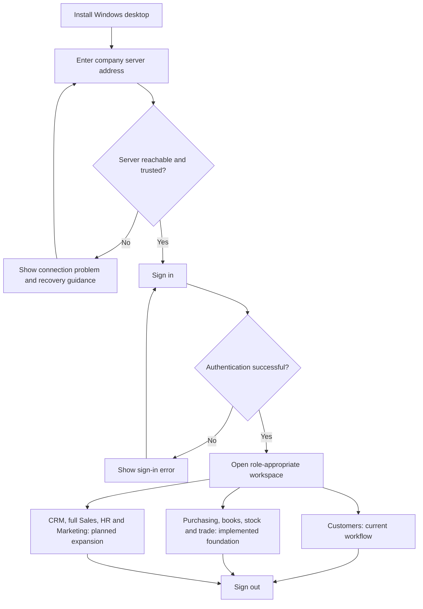
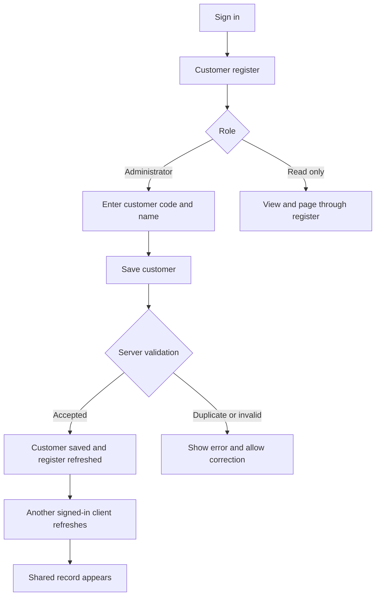
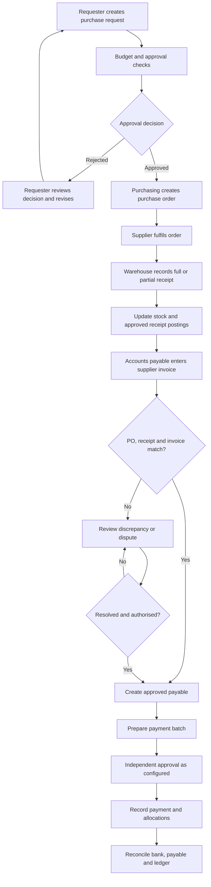

# SMB ERP Desktop — Application Flow

**Status:** Draft for product, operations and engineering review  
**Version:** 0.2\
**Date:** 17 November 2026\
**Related documents:** [Desktop PRD](SMB_ERP_DESKTOP_PRD.md), [Technical requirements](SMB_ERP_TECHNICAL_REQUIREMENTS.md), [Current migration status](DESKTOP_MIGRATION.md)

This document maps the user's journey through the Windows desktop application and its shared on-premises server. It is based on the supplied web PRD and architecture, adapted to the agreed Electron desktop, NestJS server and PostgreSQL stack. The original documents are reference material, not a description of the current implementation.

**Status labels:** **Current** means the repository implements the described basic workflow. **Planned P0** means required for the first operational ERP release. **Later** means a future phase. Proposed screens, transitions and role assignments are design inputs to review, not promises that those features already exist.

## 1. Product-wide flow

All business data is shared through the customer-operated application server. The desktop client must reach that server to perform work. It does not connect directly to PostgreSQL and does not currently support offline transaction synchronisation. Remote production connections use HTTPS with a trusted certificate; local loopback HTTP is for development.

## 2. Roles and workspace access

The current schema 7 app has nine fixed roles and one role per account. [User guide roles/navigation](USER_GUIDE.md#roles-and-navigation) and [authentication](AUTHENTICATION.md) describe actual grants. The table below distinguishes implemented responsibilities from proposed configurable scope. Server-side authorisation remains decisive.

| Role | Workspace and actions | Status |
| --- | --- | --- |
| Administrator | Customers, masters, books initialisation, access, imports/privacy and authorised audit. | Implemented; no business approval/payment execution grant. Configurable policy is planned. |
| Requester | Create and track own purchase requests. | Implemented. |
| Business approver | Decide other users' assigned requests, invoice price exceptions and payment batches. | Independent decisions implemented; configurable limits/delegation planned. |
| Purchasing | Maintain suppliers/items, issue orders and cancel remaining quantities. | Implemented; extended sourcing planned. |
| Inventory manager | Receive goods and maintain warehouses/stock. | Implemented; no financial statement access; dispatch/quality scopes planned. |
| Accountant | Invoices, payment preparation/recording, collections, books and reconciliation. | Implemented; financial correction/opening extensions planned. |
| Reader / identity administrator / auditor | Customer read / restricted reader provisioning / authorised broad read and audit. | Implemented distinct roles; consult actual grants. |
| CRM/Sales, HR and Marketing | Prospect/commercial, employee and campaign workflows. | Planned; no corresponding role grants exist. |

Composable roles are a proposed access redesign, not current behaviour. Preserve self-approval restrictions and two distinct payment approvers through that redesign. Future module record/field/export scopes require review before implementation.

## 3. Installation, connection and sign-in

### 3.1 Deployment and initial setup

**Current:** A development Windows installer can be built for the desktop. The customer server and PostgreSQL are set up separately. The current installer is unsigned unless explicitly built with signing credentials; release signing and production deployment remain outstanding.

**Planned P0:**

1. Customer IT prepares the application server, PostgreSQL, network access, trusted certificate, accounts and backups using approved deployment procedures.
2. IT installs a signed, supported desktop version on each workstation and supplies the server's HTTPS address.
3. The user opens the application, enters the server address and selects **Connect**. The client verifies connectivity and certificate trust.
4. If the connection succeeds, the user signs in with an assigned account. The user completes mandatory MFA; first use includes authenticator enrolment and recovery-code acknowledgement.
5. The server authenticates the user and the desktop opens the workspace permitted by that user's roles. An incompatible client is directed to upgrade before unsafe operations.

Initial administrator enrolment, mandatory TOTP MFA/recovery codes and user access management are current features. Full password/MFA recovery and client/server compatibility negotiation remain planned. A database password is a server deployment credential and is not entered in the desktop sign-in screen.

### 3.2 Current sign-in and sign-out

1. On the connection screen, enter the server address and select **Connect**. On the same computer, the local development address is the default; remote servers need HTTPS.
2. Enter the email and password of a provisioned account and select **Sign in**. Complete mandatory MFA; first sign-in includes authenticator enrolment and recovery-code acknowledgement. Successful authentication opens the permitted workspaces; follow the [current sign-in guide](USER_GUIDE.md#sign-in-and-set-up-mfa).
3. An invalid login or connection failure is displayed on screen. Diagnostic logs can be opened from the application.
4. Select **Sign out** to clear the local session and return to the connection screen. If the server cannot be reached, local sign-out still occurs; the server session expires according to its configured limits.

## 4. Current customer flow

The server checks permissions and validation, writes the customer and its audit event, and records the retry result in the same transaction. The administrator can retry the same pending creation without intentionally creating a second customer. A read-only user can list customers but cannot create them. Customer creation alone creates no invoice or journal. Separate service invoicing and accounting are implemented; sales orders, CRM and stocked dispatch remain planned.

## 5. Planned application navigation

After sign-in, a proposed role-aware workspace would expose only the modules the user may access. Names and visual layout are subject to design review.

| Navigation area | Typical destination | Phase |
| --- | --- | --- |
| Home / work queue | Assigned approvals, exceptions and operational notifications. | P0; enhanced dashboard later. |
| Purchasing | Suppliers, requests, purchase orders, receipts and matching exceptions. | P0. |
| Inventory | Items, warehouses, movements, balances and valuation. | P0. |
| Finance | Supplier invoices, payment batches, ledger, bank reconciliation and period close. | P0. |
| Reports | Permission-controlled operational and financial reports. | Essential reports P0; broader analytics later. |
| Administration | Users, roles, approval rules and authorised configuration/audit views. | P0. |
| CRM and Sales | Contacts, pipeline, quotations, sales orders and fulfilment. | Roadmap phase 2; current customer register/service AR remain available. |
| Supply Chain extensions | Replenishment, sourcing, quality and stock controls. | Phase 3; basic reservations/dispatch accompany Sales in phase 2B. |
| HR | Employees, leave/attendance and expenses. | Phase 4; payroll separately gated. |
| Marketing | Campaigns, eligible audiences and source/results reporting. | Phase 5; outbound delivery separately gated. |

Users should be able to move from a summary to its source document, view permitted related records and return to their work queue. Keyboard access, clear focus, validation errors and empty/loading states are required across flows.

## 6. Procure-to-pay target — implemented foundation and planned controls

The request → approval → order → accepted receipt → matched invoice → two-approver payment recording path is implemented. The target below also includes planned budgets, configurable approvals/tolerances and supplier payment-detail controls; use [current trade workflows](TRADE_WORKFLOWS.md) for actual steps. RFQ/quote comparison is proposed phase 3 work and is not required for the current path.

### 6.1 Supplier and item setup

1. An authorised user creates or selects a supplier and checks its status, payment details and relevant tax information.
2. An authorised inventory user creates or selects the item, unit of measure and warehouse/location. Access to sensitive supplier fields is restricted.
3. A change to supplier bank details follows the configured independent approval and audit process before it can be used for payment.

### 6.2 Purchase request and approval

1. The requester selects items, quantities, estimated costs and a business reason, then submits the request.
2. The server validates the data, checks the configured budget and determines the required approver. A budget exception is presented for review under the agreed policy.
3. The assigned approver reviews the request and budget context, then approves or rejects it. A prohibited self-approval is refused by the server.
4. The requester sees the decision and reason. A rejected request can be revised or closed according to the final state rules. Approval decisions and material changes remain traceable.

### 6.3 Purchase order and receipt

1. Purchasing converts an approved request to a purchase order, selects a supplier and confirms quantities, prices, tax and expected delivery details.
2. The order follows its configured approval and change controls. The method for sending an order to the supplier is a separate integration decision.
3. On delivery, warehouse staff select the order and record received and accepted quantities and their location. Partial deliveries are supported; shortages and damaged items are recorded separately.
4. The server updates eligible stock and creates receipt-related accounting entries according to the approved posting matrix. Outstanding order quantities remain visible for subsequent receipts.

### 6.4 Invoice, matching and payment

1. Accounts payable records the supplier invoice against the relevant order and receipt. The application checks for likely duplicates.
2. The server compares the order, accepted receipt and invoice using configured tolerances. A complete, eligible match may proceed according to approval rules.
3. Missing receipts, quantity/price discrepancies, duplicate warnings or other exceptions are presented for authorised investigation. A reviewer records the resolution or dispute; unmatched items do not silently proceed to payment.
4. Finance prepares a batch from eligible outstanding payables. Required independent approvers review the batch; the server enforces separation of duties.
5. An authorised user records payment and allocation after the actual payment method has been agreed and performed. Banking integration and automatic external transfers are not assumed.
6. Finance reconciles the payment, bank statement, payable balance and ledger. Each transaction links back to its source and approval history.

## 7. Inventory and Finance target — implemented foundation and planned extensions

### Inventory

1. An authorised user opens stock by item, warehouse and location, with available source movements.
2. Receipts, transfers and approved adjustments create traceable movements with reason and actor. Negative stock remains blocked under the current policy.
3. Finance and warehouse users compare stock valuation and movements with the ledger and resolve discrepancies. The valuation method and posting rules require accounting review.

### Period close and reports

1. Finance reviews open items, bank reconciliation, payables and inventory-to-ledger reconciliation.
2. The user produces an authorised trial balance and financial statements and investigates discrepancies through source-document drill-through.
3. An authorised user closes the period; the server rejects unauthorised postings to it. A permitted reopening and later adjustments are recorded.
4. Corrections to posted entries use authorised reversals or adjustments. They do not silently overwrite the original accounting record.

Country-specific tax configuration, reporting and posting rules must be selected and reviewed before production use. The first jurisdiction remains undecided.

## 8. Planned administration, privacy and recovery — P0

### User and approval administration

An authorised administrator provisions a named user, assigns the minimum required roles and approval limits, and enables the agreed authentication controls. Role changes and account disablement take effect on the server and are audited; disabled users cannot continue to perform authorised actions. Administrators review pending approvals, exceptions and audit information within their permissions.

### Data requests and retention

An authorised privacy administrator locates relevant personal records, reviews the request and produces an appropriate export, correction, restriction or deletion/anonymisation outcome. The organisation decides how applicable legal and financial retention obligations affect each request. Audit the decision and handle backups according to the approved retention and restore procedures. Current limited schema 7 case tools are described in [imports/privacy](IMPORTS_AND_PRIVACY.md); broader discovery, retention and future-module coverage remain planned and do not independently establish GDPR compliance.

### Backup, restore and upgrade

Customer IT monitors scheduled encrypted backups and periodically restores a representative backup into an isolated environment. IT verifies representative data and reconciled balances against agreed recovery objectives. For upgrades, IT checks client/server/database compatibility, takes a verified backup, applies the supported migration and validates the result. Recovery may require restoring a compatible backup; a database rollback is not assumed to be automatic.

## 9. Errors and alternate paths

| Situation | Expected user-facing flow | Status |
| --- | --- | --- |
| Server unavailable or address invalid | Show a connection error; user checks the address/network or contacts IT, then retries. | Basic connection error exists; richer guidance planned. |
| Untrusted or invalid certificate | Reject the connection; direct the user to IT to correct trust or certificate configuration. Do not offer a bypass. | Security boundary exists; wording and acceptance tests remain to be reviewed. |
| Invalid credentials or expired session | Show a safe error; user signs in again or follows the approved recovery process. | Login and session expiry exist; account recovery planned. |
| Permission denied | Explain that the action is unavailable and direct the user to an administrator where appropriate. Server rejects the action even if directly requested. | Nine fixed roles enforced; configurable and future-module scope planned. |
| Input invalid or duplicate | Show actionable validation or duplicate feedback; allow correction without losing unrelated input where feasible. | Customer validation exists; ERP-wide behaviour planned. |
| Connection lost during a write | Distinguish an unsent change from an uncertain outcome; reconnect and check the server record. Retry with the same operation identity where supported. Do not silently queue financial writes. | Current domain mutations have idempotency; every future module must extend it. |
| Competing changes | Reject stale or conflicting updates and let the user refresh and resolve them. | Implemented version checks; extend to new entities. |
| Match or approval exception | Hold the affected item, show its reason and assigned reviewer, and record the authorised decision. | Fixed request/payment decisions and invoice price exceptions implemented; broader policies planned. |
| Client/server version mismatch | Block unsupported operations and provide upgrade instructions. | Planned P0. |

For support, share the on-screen diagnostic reference and approved log entries with an administrator. Do not share credentials or the `.env` file.

## 10. Planned module flows

| Flow | Proposed journey | Roadmap phase / candidate epic |
| --- | --- | --- |
| CRM to Sales | Contact/lead → qualification → opportunity → duplicate-reviewed customer link/conversion → quotation → accepted sales order. | 2A/2B; MOD-CRM-01 and MOD-SLS-01. No journal for qualification, quote or order. |
| Stocked order to cash | Order → reserve → pick/partial dispatch → linked invoice → confirmed collection; linked return/credit/refund for correction. | 2B; MOD-SLS-02. Current service AR continues without stock/COGS. |
| Supply Chain | Explainable shortage → reviewed request → RFQ/quote selection → approved order → receipt/quality → invoice/payment; supplier return/count exceptions. | 3; MOD-SCM-01/02. Current purchasing path remains supported. |
| HR and expenses | Employee → leave/attendance → scoped independent review; expense claim → approval → Finance payable → confirmed settlement. | 4; MOD-HR-01/02. Payroll separately specified. |
| Marketing | Campaign plan → permitted audience/source → CRM lead/opportunity → order/invoice attribution → cost/funnel review. | 5; MOD-MKT-01. Sending is optional MOD-MKT-02 after provider gate. |
| Manufacturing, assets, projects, portals and multi-company | Production, depreciation, project delivery/billing and advanced extensions. | Conditional later scope with separate requirements; no first-increment commitment. |

Planned order states distinguish acceptance, fulfilment, billing and closure. Cancelling an outstanding quantity releases only eligible reservations; it does not erase prior dispatch/invoices. Physical return and financial credit are related but separate events. Reconnect/retry must not repeat stock, cost, billing or settlement.

Planned HR leave uses own/manager/HR views with balanced allocations under concurrent decisions. Claimants cannot approve their claims. Employee offboarding initiates an authorised access review; deleting an employee is not a login-revocation mechanism.

Planned Marketing audience snapshots do not override later suppression. Any future send rechecks eligibility; withdrawal prevents unsent messages under the defined policy. Recovery keeps delivery paused until restrictions and external message outcomes are reconciled. Campaign attribution and opportunity wins do not post revenue.

Phase order, epic dependencies and acceptance are owned by the [module roadmap](ERP_MODULE_ROADMAP.md). All new flows in this section remain proposed. Mobile/browser approvals and warehouse access remain open product decisions; the desktop requires server connectivity.

## 11. Flow acceptance and open decisions

The first operational release should demonstrate that two users with different permissions can complete the P0 purchase-to-payment flow, including partial receipt, invoice exception, independent approval and reconciled accounting. Acceptance must also cover denied actions, duplicate/retried writes, connection loss, accessible navigation, backup restoration and a clean Windows installation. See the [PRD acceptance criteria](SMB_ERP_DESKTOP_PRD.md#6-core-workflows-and-acceptance-criteria) and [technical verification requirements](SMB_ERP_TECHNICAL_REQUIREMENTS.md#11-verification-and-release-acceptance).

Before the planned flows can be finalised, product and engineering need decisions on the first jurisdiction and posting rules; the pilot organisation and role matrix; RFQ scope; payment method and banking integration; MFA and account recovery; mobile access; and backup, signing and server administration responsibilities. Screen labels, exact states and transitions remain subject to design and accounting review.
