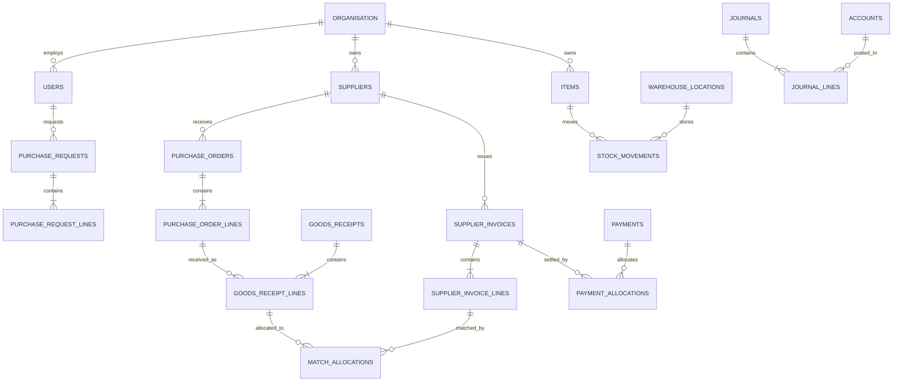

# SMB ERP Desktop — Backend Schema Document

**Status:** Draft for engineering, database, security and accounting review  
**Version:** 0.1  
**Date:** 15 November 2026  
**Related documents:** [Product requirements](SMB_ERP_DESKTOP_PRD.md), [Technical requirements](SMB_ERP_TECHNICAL_REQUIREMENTS.md), [Application flow](SMB_ERP_APP_FLOW.md), [Deployment](DEPLOYMENT.md)

## 1. Purpose and scope

This document describes the existing PostgreSQL schema and a proposed backend data model for the first operational ERP release. The NestJS server owns validation and database access; Electron desktop clients access data through the server API and do not connect directly to PostgreSQL.

**Existing** means defined in the repository migrations at the time of this draft. **Proposed P0** means a design for future implementation and review; no migration, API endpoint or business capability is implied. Future modules are outlined separately. The product and technical requirements are design inputs, not evidence of implemented functionality.

The first jurisdiction, currency, accounting policy, stock costing and retention periods remain undecided. A qualified accountant must approve posting rules, tax and reconciliation requirements before implementation and production use. This document is not executable DDL and does not authorise changes to an existing database.

## 2. Current implementation

**Implementation update:** Migration 3 now expands user roles, adds encrypted MFA fields and authentication versions, invalidates legacy sessions, permits unauthenticated audit actors, and creates `erp_auth_challenges` and `erp_mfa_recovery_codes`. See [the migration source](../apps/server/src/database/migrate.ts) and [authentication](AUTHENTICATION.md). The tables below describe the original migration 1–2 baseline; proposed business-domain tables remain unimplemented.

The authoritative definition is [migrate.ts](../apps/server/src/database/migrate.ts). Migrations 1 and 2 define the following tables; `erp_schema_migrations` records applied versions. The schema shown here is not a substitute for checking the actual database's applied migrations.

| Existing table | Columns and constraints | Purpose |
| --- | --- | --- |
| `erp_schema_migrations` | `version INTEGER` PK; `applied_at TIMESTAMPTZ NOT NULL DEFAULT now()` | Applied schema versions. |
| `erp_customers` | `code VARCHAR(32)` PK with uppercase alphanumeric/underscore/hyphen check; `name VARCHAR(160) NOT NULL` and nonblank check; `created_at TIMESTAMPTZ NOT NULL` default current time. | Shared customer register; customer code is currently the primary key. |
| `erp_users` | `id UUID` PK; unique `email VARCHAR(254) NOT NULL`; `password_hash TEXT NOT NULL`; `role TEXT NOT NULL` restricted to `admin`/`reader`; `active BOOLEAN NOT NULL DEFAULT true`; `created_at TIMESTAMPTZ NOT NULL DEFAULT now()`. | Named local accounts and current two-role access model. |
| `erp_sessions` | `token_hash TEXT` PK; `user_id UUID NOT NULL` FK to users; `expires_at TIMESTAMPTZ NOT NULL`; `last_seen_at TIMESTAMPTZ NOT NULL DEFAULT now()`; index on `user_id`. | Hashed session tokens and expiry tracking. |
| `erp_login_attempts` | `email VARCHAR(254)` PK; `attempts INTEGER NOT NULL DEFAULT 0`; `window_started TIMESTAMPTZ NOT NULL DEFAULT now()`. | Sign-in throttling. |
| `erp_audit_events` | `id BIGSERIAL` PK; `actor_id UUID NOT NULL` FK to users; `action TEXT`, `entity_type TEXT`, `entity_id TEXT`, `occurred_at TIMESTAMPTZ`, `changes JSONB`, all required. | Current business/security audit records. |
| `erp_idempotency` | `actor_id UUID` FK to users and `request_id UUID`, composite PK; `payload JSONB NOT NULL`, `response JSONB NOT NULL`. | Customer-create retry records. |

Customer creation, its audit entry and retry response are committed in one database transaction. The audit trigger rejects ordinary updates, deletes and truncation; a database owner can bypass it, so it is not tamper-proof. Existing schema does not implement MFA, granular roles, suppliers, purchase orders, stock or accounting. The planned model below is a target, not a description of these tables today.

## 3. Modelling conventions for the proposed schema

- **Naming:** Proposed entity names below are logical names. Resolve physical `erp_` prefixes and migration compatibility before implementation.
- **Keys:** `id UUID PK` means a stable UUID primary key. `FK` indicates a foreign key; `UQ` indicates a unique constraint. `?` denotes nullable. Foreign keys are required unless marked optional.
- **Ownership:** P0 assumes a single legal organisation per deployment. `organisation_id` on business records is proposed for explicit ownership and future extensibility; it does not by itself provide multi-tenant isolation or implement multi-company consolidation. Require matching organisation ownership for related records through composite keys/constraints or equivalent enforced database logic.
- **Common fields:** Unless explicitly exempted, mutable proposed business records have `created_at TIMESTAMPTZ`, `created_by UUID FK users`, `updated_at TIMESTAMPTZ`, `updated_by UUID FK users`, and `version BIGINT` for optimistic concurrency. Server-managed event/history records use the relevant actor and occurrence timestamp instead. UTC instants use `TIMESTAMPTZ`; legal/accounting dates use `DATE`.
- **Precision:** Illustrative types are `NUMERIC(19,4)` for money and `NUMERIC(20,6)` for quantities. They are **provisional**, not country defaults; agree precision, currency minor units, rounding and overflow rules before migration. Authoritative calculations must use exact decimals or appropriately scaled integers.
- **Statuses:** Proposed state names are conceptual, not exhaustive database enums. Specify allowed transitions and actor permissions in domain rules before introducing constraints. Server-side validation is supported by database constraints and transactions.
- **Deletion:** Protect financial and stock history against destructive cascades. Use inactive status for master data and controlled reversal or adjustment for posted records; privacy handling and statutory retention remain subject to policy.
- **External references:** A polymorphic reference described as `(source_type, source_id)` requires a governed type registry and enforced integrity mechanism, or preferably concrete link tables/foreign keys; it must not be treated as a normal enforceable FK on its own.

## 4. Proposed domain relationships

This is a conceptual diagram, not a complete schema. Purchases may combine requests and be invoiced or received in parts; link tables and constraints below handle those cases. A payment batch groups payment instructions; it is distinct from a recorded payment and from an actual bank transfer.

## 5. Proposed P0 identity, security and workflow

The following tables supplement or replace parts of the existing model via explicit migrations; they do not yet exist.

| Entity | Proposed fields | Keys and rules |
| --- | --- | --- |
| `organisations` | `id UUID PK`, `name TEXT`, `base_currency CHAR(3)`, `time_zone TEXT`, `status TEXT` | P0 single organisation; currency/time zone selected and validated for the deployment. |
| `users` | `id UUID PK`, `organisation_id FK`, `email TEXT`, `password_hash TEXT?`, `active BOOLEAN` | Unique normalised email within the agreed identity scope; local password optional only if an approved external identity method is introduced. Existing users need a migration plan. |
| `roles`, `permissions` | Each: `id UUID PK`, `code TEXT`, `description TEXT` | Unique role and permission codes in the applicable scope. |
| `user_roles`, `role_permissions` | `user_id FK`, `role_id FK`; `role_id FK`, `permission_id FK` | Composite PK on each pair. Define scope/validity and administrative ownership before use. |
| `sessions`, `mfa_credentials` | Session: `token_hash TEXT PK`, `user_id FK`, `expires_at`, `last_seen_at`, `revoked_at?`; MFA: `id UUID PK`, `user_id FK`, `method TEXT`, protected credential reference, status. | Evolve existing sessions deliberately; store no raw session token. Select MFA methods, encryption and recovery procedures before design approval. |
| `approval_rules` | `id UUID PK`, `organisation_id FK`, `workflow_type TEXT`, `version INTEGER`, `conditions JSONB`, `effective_from`, `effective_to?`, `active BOOLEAN` | Version rules so historic decisions retain their applicable policy. Validate condition schema and effective-date overlap. |
| `approval_tasks` | `id UUID PK`, `organisation_id FK`, source reference, `rule_id FK`, `assigned_to UUID FK?`, `status TEXT`, `requested_at`, `decided_at?` | Reference a specific document and version; enforce assignment, threshold and separation of duties server-side. |
| `approval_decisions` | `id UUID PK`, `task_id FK`, `actor_id FK`, `decision TEXT`, `reason TEXT?`, `decided_at` | Append decision history; require reason where policy requires. |
| `audit_events` | `id BIGINT PK`, `organisation_id FK?`, `actor_id FK?`, `actor_type TEXT`, `action TEXT`, source reference, `occurred_at`, `outcome TEXT`, `correlation_id TEXT?`, `changes JSONB?` | Allow governed system actors as well as users; avoid secrets and unnecessary personal data. Restrict write/read and protect integrity independently of normal runtime privileges. |
| `idempotency_requests` | `actor_id FK`, `operation TEXT`, `key UUID`, `request_fingerprint TEXT`, `state TEXT`, `response JSONB?`, `created_at`, `expires_at` | UQ on `(actor_id, operation, key)`; atomically store outcome and business write. Same key with different request fingerprint is a conflict. Define retention and minimise response data. |

An approval source must resolve to an existing authorised document. For P0, prefer explicit per-document link tables or a constrained document registry with a real foreign key; a bare type/id pair is insufficient for referential integrity. Failed logins and other unauthenticated events need an explicit security-event strategy because the current audit table requires an existing actor.

## 6. Proposed P0 master data

| Entity | Proposed fields | Keys and rules |
| --- | --- | --- |
| `customers` | `id UUID PK`, `organisation_id FK`, `code TEXT`, `name TEXT`, `status TEXT` | UQ `(organisation_id, code)`. A new surrogate ID is proposed; existing `erp_customers.code` must be preserved and mapped. |
| `suppliers` | `id UUID PK`, `organisation_id FK`, `code TEXT`, `name TEXT`, `status TEXT`, `tax_identifier TEXT?` | UQ `(organisation_id, code)`; record change history. Store only needed personal data. |
| `supplier_payment_details` | `id UUID PK`, `supplier_id FK`, protected account reference/details, `status TEXT`, `effective_from`, `approved_by UUID FK?` | Restrict read/write, protect sensitive values and require an approved change before use. Encryption/key management and retention need design review. |
| `units_of_measure` | `id UUID PK`, `organisation_id FK`, `code TEXT`, `name TEXT`, `precision INTEGER` | UQ `(organisation_id, code)`; define allowed conversions and fractional quantities. |
| `items` | `id UUID PK`, `organisation_id FK`, `code TEXT`, `name TEXT`, `unit_id FK`, `status TEXT`, `inventory_tracked BOOLEAN` | UQ `(organisation_id, code)`; determine item/account mappings and valuation configuration. |
| `warehouses` | `id UUID PK`, `organisation_id FK`, `code TEXT`, `name TEXT`, `active BOOLEAN` | UQ `(organisation_id, code)`. |
| `warehouse_locations` | `id UUID PK`, `warehouse_id FK`, `code TEXT`, `name TEXT`, `active BOOLEAN` | UQ `(warehouse_id, code)`; ensure location belongs to the document organisation. |

Names and tax identifiers may include personal information. Do not put bank details, contact data or tax identifiers into general-purpose logs or unrestricted audit payloads.

## 7. Proposed P0 procurement and matching

All document headers include `organisation_id`, document number, status, business dates, common metadata and version. Line numbers are unique within their document. Snapshot descriptions, prices, taxes and units needed to preserve the transaction as approved even when master data changes.

| Entity | Proposed fields | Keys and rules |
| --- | --- | --- |
| `purchase_requests` | `id UUID PK`, `organisation_id FK`, `number TEXT`, `requester_id FK users`, `status TEXT`, `requested_date DATE`, `justification TEXT` | UQ `(organisation_id, number)`; submit/approval transitions enforced on server. |
| `purchase_request_lines` | `id UUID PK`, `request_id FK`, `line_no INTEGER`, `item_id FK`, `unit_id FK`, `quantity NUMERIC(20,6)`, `estimated_unit_price NUMERIC(19,4)` | UQ `(request_id, line_no)`; quantity positive; preserve unit and price snapshots. |
| `purchase_orders` | `id UUID PK`, `organisation_id FK`, `number TEXT`, `supplier_id FK`, `status TEXT`, `currency CHAR(3)`, `order_date DATE`, `expected_date DATE?` | UQ `(organisation_id, number)`; approved changes require governed revision/approval. |
| `purchase_order_lines` | `id UUID PK`, `order_id FK`, `line_no`, `item_id FK`, `unit_id FK`, `quantity`, `unit_price`, `tax_code_id FK?` | Positive quantity; UQ `(order_id, line_no)`. Tax and price must be snapshotted according to the approved calculation rules. |
| `order_request_allocations` | `order_line_id FK`, `request_line_id FK`, `quantity NUMERIC(20,6)` | Composite PK or surrogate PK with UQ on the pair; enforce consistent item/unit/organisation and approved allocation limits. Enables split and combined requests. |
| `goods_receipts` | `id UUID PK`, `organisation_id FK`, `number TEXT`, `order_id FK`, `received_at TIMESTAMPTZ`, `received_by FK users`, `status TEXT` | UQ `(organisation_id, number)`; constrain each receipt line to the same order and organisation. |
| `goods_receipt_lines` | `id UUID PK`, `receipt_id FK`, `order_line_id FK`, `location_id FK`, `received_qty`, `accepted_qty`, `damaged_qty` | Quantities nonnegative; accepted and damaged cannot exceed received under the agreed definition. Record shortage against outstanding ordered quantity; permit multiple partial receipts. |
| `supplier_invoices` | `id UUID PK`, `organisation_id FK`, `supplier_id FK`, `supplier_invoice_number TEXT`, `invoice_date DATE`, `due_date DATE`, `currency CHAR(3)`, `status TEXT`, `total NUMERIC(19,4)` | Define supplier/number normalisation and duplicate-warning policy with finance; do not assume one universal unique rule across jurisdictions. |
| `supplier_invoice_lines` | `id UUID PK`, `invoice_id FK`, `line_no`, `order_line_id FK?`, `item_id FK?`, `quantity`, `unit_price`, `tax_code_id FK?`, `line_total` | UQ `(invoice_id, line_no)`; non-PO lines and their controls require an explicit policy. Preserve tax/price snapshots. |
| `invoice_match_allocations` | `id UUID PK`, `invoice_line_id FK`, `receipt_line_id FK`, `matched_qty`, `matched_amount` | Limit total allocation to eligible accepted receipts and invoice quantities; serialize competing allocations. Permit partial/multiple matches. |
| `match_reviews` | `id UUID PK`, `invoice_id FK`, `tolerance_version TEXT`, `status TEXT`, `reason TEXT?`, `reviewed_by FK?`, `reviewed_at?` | Retain rule version, discrepancy and authorised resolution. Out-of-tolerance invoices cannot silently proceed. |

RFQ entities, supplier attachments and document transmission are undecided. Do not infer an external supplier portal or banking integration from the schema.

## 8. Proposed P0 inventory

| Entity | Proposed fields | Keys and rules |
| --- | --- | --- |
| `stock_movements` | `id UUID PK`, `organisation_id FK`, `item_id FK`, `location_id FK`, `quantity_delta NUMERIC(20,6)`, `unit_id FK`, `occurred_at TIMESTAMPTZ`, `business_date DATE`, source reference, `reason TEXT?` | Append-only movements after posting; validate unit and organisation. Every receipt movement links to its receipt line through a concrete FK/link. Transfers use linked source/destination movements. |
| `stock_balances` | `organisation_id FK`, `item_id FK`, `location_id FK`, `quantity NUMERIC(20,6)`, `version BIGINT` | Composite PK `(organisation_id, item_id, location_id)`; maintained transactionally as a projection and reconcilable to movements. Lock/update safely for concurrent writes. |
| `inventory_valuation_entries` | `id UUID PK`, `stock_movement_id FK`, `amount NUMERIC(19,4)`, `currency CHAR(3)`, `valuation_method_version TEXT`, journal link | Record cost and traceability according to the approved valuation method; reconcile to inventory control accounts. |

Negative-stock policy, cost layers versus average cost, stock reservations, returns, unit conversions and adjustment approvals require explicit decisions. Do not assume a particular valuation method in migrations.

## 9. Proposed P0 finance and accounting

| Entity | Proposed fields | Keys and rules |
| --- | --- | --- |
| `accounts` | `id UUID PK`, `organisation_id FK`, `code TEXT`, `name TEXT`, `account_type TEXT`, `active BOOLEAN` | UQ `(organisation_id, code)`; authorised mapping to source transactions. |
| `accounting_periods` | `id UUID PK`, `organisation_id FK`, `start_date DATE`, `end_date DATE`, `status TEXT`, `closed_by FK?`, `closed_at?` | No overlapping periods per organisation; closing and reopening authorised and audited. |
| `tax_codes`, `tax_rates` | Code: `id UUID PK`, organisation, code, description; rate: `id UUID PK`, `tax_code_id FK`, `rate NUMERIC`, effective dates | Date-effective configuration and non-overlap subject to accountant review. Preserve applied tax snapshot on each transaction. |
| `journals` | `id UUID PK`, `organisation_id FK`, `number TEXT`, `period_id FK`, `posting_date DATE`, `status TEXT`, source reference, `posting_rule_version TEXT`, `reversal_of_id FK?` | UQ `(organisation_id, number)`; post atomically only to open periods; posted records are immutable except controlled reversal/adjustment. |
| `journal_lines` | `id UUID PK`, `journal_id FK`, `line_no`, `account_id FK`, `debit NUMERIC(19,4)`, `credit NUMERIC(19,4)`, `currency CHAR(3)`, `description TEXT?` | UQ `(journal_id, line_no)`; nonnegative amounts, exactly one nonzero side per line, subject to agreed policy. All posted lines balance in the accounting currency. |
| `payable_items` | `id UUID PK`, `organisation_id FK`, `supplier_id FK`, `invoice_id FK`, `original_amount`, `currency CHAR(3)`, `due_date DATE`, `status TEXT` | Link invoice and liability posting; define credits and adjustments. Outstanding amount must reconcile to allocations, not be independently trusted. |
| `payment_batches` | `id UUID PK`, `organisation_id FK`, `number TEXT`, `status TEXT`, `prepared_by FK`, `approved_at?` | UQ `(organisation_id, number)`; approval and separation-of-duties rules apply before payment recording. |
| `payment_batch_lines` | `id UUID PK`, `batch_id FK`, `payable_item_id FK`, `proposed_amount`, `currency CHAR(3)` | Prevent duplicate or excessive concurrent allocations; record approval version and payment-detail version used. |
| `payments` | `id UUID PK`, `organisation_id FK`, `batch_id FK?`, `supplier_id FK`, `payment_date DATE`, `amount`, `currency CHAR(3)`, `status TEXT`, `external_reference TEXT?` | A record is not evidence of bank execution unless independently confirmed by an approved integration or reconciliation. |
| `payment_allocations` | `id UUID PK`, `payment_id FK`, `payable_item_id FK`, `amount NUMERIC(19,4)` | Enforce supplier/currency compatibility and allocation limits atomically; support partial settlement. |
| `bank_accounts`, `bank_transactions` | Account: `id UUID PK`, organisation, protected account reference, linked ledger account; transaction: `id UUID PK`, `bank_account_id FK`, `date DATE`, `amount`, `external_reference TEXT?` | Protect account details; define duplicate import detection and source provenance. |
| `bank_reconciliation_allocations` | `id UUID PK`, `bank_transaction_id FK`, `journal_line_id FK`, `amount NUMERIC(19,4)` | Support reviewed partial/multiple matches and prevent over-allocation. |
| `receivable_items`, `customer_receipts` | IDs, organisation, customer FK, source, amount, currency, dates and status; allocation table for settlement. | P0 opening receivables and receipts require an approved source and posting design; expanded sales invoices are P1. |

Cross-row balance cannot be guaranteed by a simple row `CHECK`: enforce it at the posting transaction boundary using database-backed locking/constraints or equivalent, with tests. If transaction and accounting currencies differ, specify exchange rates, amount columns and gain/loss treatment before enabling them. Do not infer debit/credit mappings or tax compliance from this model.

## 10. Transaction, concurrency and API boundaries

1. **Request/approval:** Validate permission, organisation, document version, policy and separation of duties; commit transition, decision and audit event together. An out-of-date decision returns a conflict.
2. **Receipt:** Lock the relevant order lines and stock balance rows, validate remaining quantities, then atomically persist receipt, accepted movements, valuation, applicable journal and audit. A failure rolls back the entire event.
3. **Invoice matching:** Lock or otherwise serialize competing receipt allocations. Validate supplier, organisation, quantities, prices and policy version; commit match/exception and related audit together.
4. **Payment:** Check payable availability and independent approvals in the same controlled transaction as payment/allocation/posting. Do not mark a bank transfer successful merely because a payment record was created.
5. **Retries:** Apply operation-scoped idempotency to all relevant financial and stock writes. A retry after a lost response returns the recorded outcome; a different payload with the same key is rejected. Define key lifetime and reconciliation after expiration.
6. **Reads:** Return paginated, permission-scoped results. Never expose password hashes, raw tokens, protected bank data or unrestricted audit payloads in general responses.

Every proposed invariant must have a named enforcement point and concurrency test. Database transactions, constraints and locks complement server authorisation; UI validation does not replace either.

## 11. Indexing, security and operations

- Add indexes for foreign keys and frequent access paths based on actual queries and `EXPLAIN`, such as document `(organisation_id, status, date)`, stock `(organisation_id, item_id, location_id)`, approval assignee/status and journal period/account. Do not add every suggested index blindly; measure write cost and query plans.
- Enforce unique business codes and document numbers within their agreed organisation scope. Decide case and Unicode normalisation before creating uniqueness constraints.
- Run the application with a restricted database role; use separate migration and backup roles. A superuser or database owner can bypass ordinary table controls, so operational separation and monitoring are required.
- Encrypt production data and backups at rest with a documented deployment approach; protect credentials and keys outside the repository. Apply least-privilege access, retention and incident procedures to database, audit and diagnostic data.
- Identify personal data by purpose and retention category. Support authorised access/export, correction, restriction and deletion or anonymisation when appropriate; assess statutory accounting retention and backup lifecycle before deletion. Software features alone do not establish GDPR compliance.
- Monitor connection pool, slow queries, storage, migration status, backup success and restoration. Set recovery point/time targets with the customer and test isolated restores and reconciliation.

## 12. Migration strategy from the current schema

This is a proposed sequence; no migration is performed by creating this document.

1. Inventory the deployed migration versions, data volume, users, customer codes and dependencies; take and restore-test a backup before changing production data.
2. Add an organisation record and nullable ownership/surrogate identifiers as needed; backfill deterministically. Preserve every current customer code and verify counts and uniqueness.
3. Introduce new customer IDs and a mapping from existing codes; migrate all new references before changing any primary key. During a compatibility window, maintain the existing customer API contract or provide a reviewed version transition.
4. Add roles/permissions and map existing `admin` and `reader` users without elevating privileges. Plan session compatibility, MFA enrolment and rollback; do not discard user credentials or audit history.
5. Add procurement, inventory and accounting tables in dependency order, then add validated constraints and indexes. Keep the migration role separate from normal runtime access.
6. Reconcile counts, IDs, permissions and balances; run integration and concurrency tests, then switch traffic using a documented maintenance and recovery plan. Restore the verified backup or use a reviewed forward repair if a migration cannot be safely reversed.

Production schema migrations require versioned scripts, review, staging rehearsal, compatibility checks and recorded deployment outcomes. The current migration runner is the starting point; it does not by itself provide the complete operational process above.

## 13. Verification checklist

| Area | Required evidence |
| --- | --- |
| Existing schema | Migration versions and table constraints match the actual deployment; no data or credentials are exported unnecessarily. |
| Keys and scope | FK/unique violations, cross-organisation links and prohibited deletes are rejected; code-to-UUID migration preserves all records. |
| Permissions | Server rejects unauthorised reads/writes and restricted reports, including direct API calls. |
| Accounting | Posting is balanced, periods enforced, corrections traceable, subledgers and inventory reconcile to control accounts using approved rules. |
| Concurrency | Parallel receipts, invoice matching and payment allocations cannot over-consume the same outstanding quantity or balance. |
| Retry and rollback | Duplicate submissions return the same result; conflicting payloads fail; induced failures leave no partial stock or financial postings. |
| Privacy and audit | Protected values do not appear in logs or general API responses; audit access and retention are controlled; data requests account for legal holds/backups. |
| Recovery and migrations | Production-like backup restores in isolation; migration/upgrade and recovery are rehearsed and reconciled. |

## 14. Open design decisions and later modules

Before implementing P0, agree the first jurisdiction, base currency, tax treatment, accountant-reviewed posting matrix, precision and rounding, inventory valuation/negative-stock policy, supplier invoice duplicate policy, role/approval matrix, document state transitions, bank integration, retention, encryption/key ownership, and supported PostgreSQL version. Confirm whether `organisation_id` is required in the first physical schema and how to enforce ownership consistently.

Later modules require their own reviewed schema: sales quotes/orders/deliveries/invoices and returns; fixed assets and depreciation; manufacturing BOM/work orders; projects and billing; HR, leave, expenses and jurisdiction-specific payroll; integration events and webhooks. Their names here are planning placeholders, not implemented tables or approved data models.
