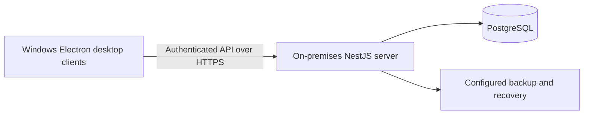

# SMB ERP Desktop — Product Requirements Document

**Status:** Draft for product, engineering, accounting and privacy review  
**Version:** 0.2\
**Date:** 17 November 2026\
**Sources:** `SMB_ERP_PRD.md` and `ERP_Architecture.md`; adapted to the agreed desktop direction.

This document describes the intended product and release requirements. Requirements and targets are proposals until approved; they are not a claim that the existing application already implements them. The original documents are product inputs, not implementation instructions. Where their web-specific assumptions differ from the decisions below, this document records the desktop adaptation.

## 1. Product overview

Build an ERP for small and medium-sized businesses, initially targeting organisations with approximately 20–150 employees. Staff use a Windows desktop application to work with shared company data on a customer-controlled, on-premises server. The first complete release centres on procure-to-pay, supported by finance, inventory, administration and reporting.

The product should replace disconnected spreadsheets and manual handoffs with traceable transactions, role-based approvals and consistent accounting records. The [module expansion roadmap](ERP_MODULE_ROADMAP.md) proposes six connected areas: Finance, Sales, CRM, Supply Chain, HR and Marketing. Manufacturing, projects and other extensions remain separately scoped later work. ERPNext supplies workflow inspiration through the [reference crosswalk](ERPNEXT_MODULE_CROSSWALK.md); the agreed desktop stack remains unchanged.

### Agreed product and technology decisions

- Windows is the first supported desktop operating system. Other platforms are undecided.
- The desktop client uses Electron, React and TypeScript. The shared application server uses NestJS and TypeScript, with PostgreSQL as the system of record.
- Multiple users connect over the customer's network to an on-premises server. Desktop clients do not connect directly to PostgreSQL.
- The first country and associated tax and accounting rules are **undecided**. A supported jurisdiction and reviewed configuration are release decisions, not assumptions.
- GDPR support is a product objective. Compliance also depends on the customer's configuration, procedures and legal obligations; it cannot be guaranteed by software alone.

### Current baseline

Source baseline 0.2.0 / schema 8 includes mandatory MFA, nine fixed roles, customer/supplier/item masters, request approval, orders/receipts, INR books and weighted stock, AP/AR, payment approvals/recording, collections, reconciliation/statements, master imports and limited privacy operations. See the [user guide](USER_GUIDE.md) for implemented tasks and limits. Full stocked Sales, CRM, HR and Marketing are not implemented. Finance and Supply Chain are partial foundations. Requirements below include both implemented slices and remaining target behaviour; source availability and an installer do not establish deployment or production acceptance.

## 2. Users and needs

| User | Primary needs |
| --- | --- |
| Owner or management | Reliable visibility of cash, liabilities, stock and business performance. |
| Finance and accounts payable | Accurate ledger, invoice matching, payment controls, reconciliation and period close. |
| Purchasing | Request, approve and order goods; track supplier commitments and exceptions. |
| Warehouse | Receive goods, record shortages or damage and view stock by location. |
| Sales and accounts receivable | Manage customers, orders, invoices, collections and returns in later phases. |
| CRM and sales operations | Qualify leads, manage contacts/opportunities and hand accepted business to Sales without duplicate customers. |
| Marketing | Plan campaigns, maintain eligible audiences and measure source-to-revenue results within permitted data scope. |
| HR and operations | Manage permitted workforce, manufacturing and project information in later phases. |
| IT administrator | Install and maintain the client and server, control access, recover data and diagnose failures. |
| Auditor or privacy administrator | Review authorised records and decisions, and support relevant data requests. |

## 3. Goals, measures and boundaries

### Product goals

1. Complete the purchase request → purchase order → goods receipt → supplier invoice → payment → general ledger workflow with traceable approvals and accounting.
2. Give authorised employees a consistent view of shared data across Windows workstations.
3. Reduce duplicate entry, mismatches and manual reconciliation while preserving review of exceptions.
4. Provide a secure, recoverable on-premises deployment with privacy-supporting controls.
5. Establish a platform for later sales, operations and country-specific extensions.

### Proposed success measures

The following are inherited targets from the source PRD unless stated otherwise. Confirm the workload, dataset, measurement period and customer acceptance method before committing to them.

| Measure | Target | Measurement |
| --- | --- | --- |
| Concurrent users | 50 | Representative mixed workload against the agreed server specification. |
| Availability | 99.5% during agreed business hours | Server and network monitoring, with maintenance window and measurement period agreed with the customer. |
| Common screen response | P95 under 2 seconds | After navigation on a supported workstation and network, with a representative dataset. |
| Routine API response | P95 under 500 ms | Server-side measurement for representative operations; exclude explicitly identified long-running jobs. |
| Standard financial statements | Under 30 seconds | Representative data volume and report definitions agreed before testing. |
| Automatic three-way match | More than 80% | Eligible invoices with complete PO and receipt data; track exclusions and exceptions. |
| Purchase transaction | PO → receipt → invoice in under 10 minutes | Timed representative scenario excluding time spent waiting for physical delivery and approvals. |
| Customer onboarding | Four weeks | From agreed project start to a reconciled operational deployment, subject to data readiness and scope. |

These are validation targets, not measured results. Network, hardware, data volume and customer operational responsibilities must be stated in the test report.

### Scope and constraints

Phase 1 includes the core platform, Finance, procurement/inventory foundations of Supply Chain, essential reporting, migration and operational recovery. Section 10 refines later delivery into CRM/Sales, Supply Chain expansion, HR and Marketing. The existing controlled pilot is phase 0 and retains its own capacity. Payroll compliance, jurisdiction-specific filings, mobile applications and enterprise extensions are not implied by the initial desktop release.

The source PRD describes smartphone approvals and responsive warehouse access. Their business need remains open: Windows-only desktop does not satisfy mobile use. Product owners must decide whether and when to add a mobile or browser experience and how it will be secured. No offline multi-user writes or synchronisation are assumed; the client requires connectivity to the shared server for transactions.

## 4. Product and deployment model

The server is the authority for permissions, validation, workflow state, accounting and audit events. Customer-managed DNS or a documented server address identifies the deployment. Production clients must authenticate the server certificate and use encrypted transport; loopback HTTP may be used only for local development. A customer may operate without vendor internet connectivity, but workstations still need access to the customer server.

The installer, client, server and database have separate version and deployment lifecycles. Supported Windows versions, server operating systems, database versions, server sizing, certificate provisioning, remote access and any automated update mechanism remain to be agreed and documented. Do not embed database passwords, customer secrets or production endpoints in the installer.

## 5. Functional requirements

Priorities: **P0** is required for the first operational release; **P1** is planned next; **P2/P3** are later or optional. Source identifiers are retained for traceability. Requirement statements describe intended behaviour, not existing functionality.

### 5.1 Desktop experience and deployment

| ID | Priority | Requirement |
| --- | --- | --- |
| FR-DESK-01 | P0 | Provide an installable Windows application with an identifiable version and documented installation, upgrade and uninstall steps. Uninstalling the client must not delete the shared server database. |
| FR-DESK-02 | P0 | Allow an administrator or user, as policy permits, to configure a server address and test connectivity. Report certificate, network and authentication failures in actionable language without exposing secrets. |
| FR-DESK-03 | P0 | Keep server credentials and tokens out of renderer-accessible storage and logs; protect privileged desktop capabilities behind a narrow, validated interface. |
| FR-DESK-04 | P0 | Show pending, success and failure states for transactions. On a lost connection, preserve any unsent form data where feasible and clearly distinguish an unsubmitted change from an outcome that must be checked with the server. Do not silently queue financial writes. |
| FR-DESK-05 | P0 | Check client/server compatibility and block unsafe operations with upgrade guidance. Test upgrades and rollback against the supported database migration policy. |
| FR-DESK-06 | P0 | Provide keyboard-operable workflows, accessible labels, focus indicators and clear validation errors. Support the accessibility target in section 7. |
| FR-DESK-07 | P1 | Provide an administrator-controlled update or distribution process appropriate for managed and disconnected networks; automatic updates are not assumed. |

### 5.2 Platform, security and administration

| ID | Priority | Requirement |
| --- | --- | --- |
| FR-PLT-01 | P0 | Authenticate named users, provide secure password management, account recovery and configurable session controls; support MFA for privileged and other applicable users. |
| FR-PLT-02 | P0 | Enforce role-based permissions on the server for screens, records and actions. Administrators can provision, change and disable users without sharing accounts. |
| FR-PLT-03 | P0 | Support separation of duties for approval and payment, including prevention of self-approval where configured and a documented exception process. |
| FR-PLT-04 | P0 | Record security events and material changes with actor, time, action, affected record and outcome. Restrict access and provide evidence of attempted tampering; do not expose sensitive values unnecessarily. |
| FR-PLT-05 | P0 | Configure approval rules, thresholds, assignments, escalation and decision history for in-scope workflows. |
| FR-PLT-06 | P0 | Show in-application notifications for pending approvals, exceptions and failures. External notification channels require a later integration decision. |
| FR-PLT-07 | P0 | Provide documented, scheduled and monitored backups, restoration procedures and recovery tests, including PostgreSQL and any required configuration or file data. Define retention, encryption, key custody, recovery point and recovery time with each customer. |

### 5.3 Finance and accounting

All posting rules, tax treatment, rounding, account mappings and reversal behaviour must be reviewed by a qualified accountant for the selected jurisdiction before release. Financial amounts must use appropriate exact precision. Posted records must be traceable to their source; corrections use controlled reversal or adjustment rather than silent alteration.

| ID | Priority | Requirement |
| --- | --- | --- |
| FR-FIN-01 | P0 | Maintain a configurable chart of accounts, account types, opening balances and mappings for operational transactions. |
| FR-FIN-02 | P0 | Create balanced double-entry journals, validate posting dates and accounts, support authorised adjustments and preserve a source-to-ledger audit trail. |
| FR-FIN-03 | P0 | Maintain receivable balances and record customer receipts and allocations; expanded sales invoicing is phased separately. |
| FR-FIN-04 | P0 | Maintain supplier liabilities, invoice balances, credits and payment allocations, integrated with procure-to-pay. |
| FR-FIN-05 | P0 | Import or enter bank statement transactions, match them to ledger entries, handle exceptions and reconcile closing balances. |
| FR-FIN-06 | P0 | Configure applicable tax rates, codes and effective dates; calculate and report tax using reviewed jurisdiction-specific rules. Do not claim a country is supported until its rules and reports are validated. |
| FR-FIN-07 | P0 | Produce trial balance, profit and loss, balance sheet and relevant subledger reports with drill-through and permission-controlled export. |
| FR-FIN-08 | P0 | Support period close, restricted reopening and controls against unauthorised posting to closed periods. |

Where foreign-currency transactions are in scope, record currencies, rates, rounding and exchange differences using the accountant-approved policy. Country-specific tax submissions and payroll rules need a separately approved localisation scope.

### 5.4 Procure-to-pay

| ID | Priority | Requirement |
| --- | --- | --- |
| FR-P2P-01 | P0 | Create purchase requests with requester, items, quantities, estimated costs and business justification. Apply configurable budget and approval checks and retain decisions. |
| FR-P2P-02 | P0 | Convert approved requests into purchase orders with supplier, lines, price, tax, delivery details and status. Control changes and cancellation after approval and record their history. |
| FR-P2P-03 | P0 | Record full and partial goods receipts against purchase orders, including shortages, damage, accepted quantities and warehouse location. Update stock and receiving/clearing accounts according to approved posting rules. |
| FR-P2P-04 | P0 | Capture supplier invoices and detect likely duplicates. Match invoice, order and receipt by supplier, quantities and prices using configurable tolerances. Route missing or out-of-tolerance matches to authorised exception handling; retain the decision. |
| FR-P2P-05 | P0 | Create payable items and payment batches, apply appropriate dual approval, record payment and allocation, and post accounting entries. An external bank transfer or banking integration is not assumed. |
| FR-P2P-06 | P0 | Maintain supplier identity, payment and tax details, status and history. Restrict and audit sensitive changes, including approval of supplier bank-detail changes. |

RFQ/supplier quotations are proposed in Supply Chain phase 3 with reviewed sourcing/approval rules. The current purchase-to-payment path and core release do not depend on that future increment.

### 5.5 Inventory and warehouse

| ID | Priority | Requirement |
| --- | --- | --- |
| FR-INV-01 | P0 | Maintain item master data, units of measure and stock visibility by warehouse and location, subject to permissions. |
| FR-INV-02 | P0 | Record receipts, transfers and authorised adjustments with quantity, location, reason, actor and source transaction. Prevent or explicitly control negative stock. |
| FR-INV-03 | P1 | Configure reorder points and surface replenishment recommendations. |
| FR-INV-04 | P0 | Apply an agreed valuation method consistently and reconcile inventory balances and movements to the general ledger. |

### 5.6 Sales and CRM

Sales owns commercial commitments; CRM owns prospect qualification and customer handoff. Current customer invoicing/collections remain the service/non-stock path and do not imply sales orders, dispatch or COGS. The planned Sales increment includes a Supply Chain reservation/dispatch slice before broader replenishment and sourcing work.

| ID | Priority | Requirement |
| --- | --- | --- |
| FR-SLS-01 | P1 | Maintain customers, quotations and sales orders with status, pricing, tax and approval rules. |
| FR-SLS-02 | P1 | Record deliveries, including partial deliveries, and reflect fulfilment and stock movements. |
| FR-SLS-03 | P1 | Create sales invoices from approved source transactions and post receivables and ledger entries. |
| FR-SLS-04 | P1 | Record and allocate customer payments and receipts, reconciling to bank and receivables. |
| FR-SLS-05 | P1 | Process returns and credit notes with stock, receivable and accounting effects. |
| FR-CRM-01 | P1 | Maintain scoped contacts/addresses, leads, qualification and opportunities with ownership, stage history, follow-up activities and won/lost reasons. |
| FR-CRM-02 | P1 | Convert/link a qualified prospect to a customer exactly once with reviewed deduplication, preserved source references and no automatic ledger posting. Protect contact imports, discovery and exports. |
| FR-SLS-06 | P1 | Apply reviewed price/discount authority, customer credit holds and partial reservation/dispatch/cancellation rules without overselling; preserve accepted price/tax snapshots and invoice/source allocation. |

### 5.7 HR, manufacturing and additional operations

| ID | Priority | Requirement |
| --- | --- | --- |
| FR-HR-01 | P2 | Maintain employee records with access limited to authorised roles and configurable retention. |
| FR-HR-02 | P2 | Record leave requests, balances and approvals. |
| FR-HR-03 | P2 | Support payroll only for a specifically selected and legally reviewed jurisdiction; define calculations, reporting, integrations and retention before commitment. |
| FR-HR-04 | P2 | Record expense claims, approvals and accounting/payment integration. |
| FR-HR-05 | P2 | Maintain departments/designations, employee/manager relationships and lifecycle separately from login accounts; support reviewed attendance and leave allocation/cancellation with own/manager/HR data scopes. |
| FR-MFG-01 | P2 | Maintain versioned bills of materials and component quantities. |
| FR-MFG-02 | P2 | Create and track work orders, material consumption, output and inventory/accounting effects. |

Projects and fixed assets are future capabilities requiring separate requirements, including their accounting effects. Their appearance in the architecture is not a commitment to a first-release implementation.

### 5.8 Reporting, integration and extensibility

| ID | Priority | Requirement |
| --- | --- | --- |
| FR-RPT-01 | P1 | Provide a role-appropriate executive dashboard with defined metric calculations and refresh times. |
| FR-RPT-02 | P0 | Provide operational and financial reports needed for the initial workflow, filters, drill-through and authorised export. Broader analytics follow in later phases. |
| FR-RPT-03 | P0 | Apply data and action permissions to reports and exports, including sensitive fields. |
| FR-INT-01 | P1 | Offer a documented, versioned API for approved integrations with authentication, authorisation, rate controls and compatibility policy. The internal desktop API is required in P0. |
| FR-INT-02 | P0 | Import and export agreed master data, opening balances and operational records using documented templates, validation, error reports and reconciliation. |
| FR-INT-03 | P2 | Provide authenticated, retryable webhooks for approved business events with a documented delivery and deduplication contract. |

### 5.9 Finance, Supply Chain and Marketing expansion

These extend the retained requirement IDs above. Priorities describe release importance, not roadmap phase numbers; all additions remain proposed. Candidate epics and acceptance are in roadmap section 5.

| ID | Priority | Requirement |
| --- | --- | --- |
| FR-FIN-09 | P0 | Complete linked credits/returns/refunds and controlled opening migration, with original-source/allocation limits, tax/rounding/period rules and AP/AR/GRNI/stock/GL reconciliation. Refines FR-FIN-01/04 and existing FUP-03/04. |
| FR-FIN-10 | P1 | Extend reviewed cost centres, budgets, bank-file matching and controlled reports/exports; define duplicate handling and reproducible report calculations. |
| FR-SCM-01 | P1 | Calculate explainable replenishment suggestions from on-hand, reserved, inbound and demand quantities; require review before creating procurement commitments. |
| FR-SCM-02 | P1 | Capture RFQs/supplier quotes, compare terms and select sourcing under approval controls. Split/consolidated orders require a reviewed replacement for the current one-request/one-order constraint. |
| FR-SCM-03 | P1 | Control supplier returns, quarantine/release/disposal and count adjustment approval with source-linked stock/valuation/GRNI/AP effects; extend basic picking/dispatch without a second stock ledger. |
| FR-MKT-01 | P2 | Plan campaigns with owner, dates, budget, eligible audience and source attribution through CRM/Sales; maintain purpose/channel preferences and suppressions. |
| FR-MKT-02 | P2 | Report deduplicated lead, opportunity and realised-revenue attribution using a defined model/window, with actual costs linked to Finance and protected aggregate/detail access. |
| FR-MKT-03 | P2 | Add outbound communications only after selecting providers and defining authorisation, eligibility recheck, unsubscribe, secure callbacks, bounded retries, delivery deduplication and restore behaviour. Initial Marketing scope is planning/manual results. |

The employee claim workflow requires an independently reviewed employee-payable posting contract. Payroll is excluded from HR core acceptance. CRM stages and marketing funnel values never substitute for posted revenue.

## 6. Core workflows and acceptance criteria

The following scenarios are release acceptance criteria, subject to agreed fixtures, roles and accountant-approved posting rules.

### 6.1 Purchase to payment

1. An authorised requester submits a request. The configured approver sees it, cannot approve their own request where prohibited, and can approve or reject it with a recorded decision. Budget exceptions follow configured rules.
2. Purchasing converts an approved request into an order. The order retains its request, supplier, lines, approvals and change history. An unauthorised user cannot approve or modify protected fields.
3. Warehouse records a partial receipt, then the remainder; a damaged or short quantity is visible and not silently accepted. Accepted stock and the approved receiving postings reconcile to the source receipt.
4. Accounts payable records an invoice. A duplicate warning identifies a likely repeated supplier invoice. An eligible invoice within tolerance matches its order and receipts; a mismatch is held for an authorised decision, with reason and audit history.
5. A payment batch contains only eligible outstanding liabilities. Required independent approvals precede recording the payment. Allocations reduce the correct balances and generate balanced, traceable ledger entries.
6. Repeating a submitted transaction after an interrupted response does not create a duplicate order, receipt, invoice, payment or journal. The user can verify the final server state.

### 6.2 Financial control and recovery

- Import opening data, review validation failures, correct them and reconcile opening balances before live posting. Import errors must not silently create partial financial records.
- A trial balance balances; the inventory and payable subledgers reconcile to their control accounts; an authorised adjustment has an attributable audit trail.
- A closed period rejects unauthorised postings. An authorised reopening and subsequent adjustment are recorded.
- An administrator restores a representative encrypted backup to a separate test environment and verifies login, representative transactions and reconciliation against the defined recovery objectives.

### 6.3 Desktop and access

- Install on a clean supported Windows workstation, configure the server and sign in as two roles. Server permissions prevent a restricted user from accessing a forbidden action even if the client request is modified.
- An unreachable server, invalid certificate, expired session and incompatible client version each produce a clear and recoverable state. The client never reports an uncertain transaction as confirmed.
- An administrator upgrades a supported client and server in a staging environment, validates migrations and follows the documented rollback/recovery procedure without losing committed records.

## 7. Non-functional requirements

### Security and reliability

- Use authenticated TLS for production client/server traffic, least-privilege service and database accounts, securely managed secrets, strong password storage and dependency vulnerability management. Protect data and backups at rest using a documented customer-operated encryption and key-management approach.
- Apply Electron security controls including context isolation, a sandboxed renderer and a constrained preload/IPC boundary. Validate input and authorisation on the server; renderer controls alone are insufficient.
- Make each business transaction atomic across its database changes. Use idempotency for retried writes and concurrency controls to prevent duplicate or conflicting financial updates.
- Log operational failures and security events with correlation identifiers and useful diagnostic context. Do not log passwords, tokens or unnecessary personal and financial data. Define log access, retention and alerting.
- Publish a threat model, dependency inventory/SBOM, supported-version policy, security patch process and incident response procedure before production release.
- Sign production Windows installers with a trusted code-signing certificate and distribute through an authenticated channel. Current unsigned builds must be treated as development artifacts until this gate is met.
- Define database migrations, upgrade compatibility, tested backups and recovery before deployment. A rollback may require restoring a compatible backup; do not assume every migration is reversible.

### Performance and accessibility

Use the proposed metrics in section 3 and document test environment, data size and results. Design for keyboard navigation and assistive technology, with WCAG 2.1 AA as the accessibility target for applicable desktop content. Validate with keyboard and screen-reader testing on supported Windows configurations; document any exceptions and remediation.

### Privacy and GDPR support

Privacy by design requires technical and organisational safeguards from the start, including data minimisation, appropriate retention and restricted access. See the [European Commission guidance on data protection obligations](https://commission.europa.eu/law/law-topic/data-protection/information-business-and-organisations/obligations_en) and [GDPR principles](https://commission.europa.eu/law/law-topic/data-protection/information-business-and-organisations/principles-gdpr_en).

- Inventory personal data, purposes, recipients, storage locations and retention categories; make optional collection and access restrictive by default. The customer determines its lawful bases and provides required notices.
- Enable authorised staff to locate and export relevant personal data, correct inaccuracies, and document access, restriction and erasure requests and outcomes. Review requests against applicable obligations; erasure is not absolute, including where information must be retained by law. See the [EDPB small-business FAQ](https://www.edpb.europa.eu/sme/find-practical-info/faq_en).
- Define configurable retention and deletion or anonymisation processes, including how backups expire and how restored data is handled. Financial and employment records may have different retention requirements.
- Restrict sensitive data in reports, logs and support exports; record privileged access and material changes. Document encryption, keys, backup handling, incident response and access revocation.
- Identify controller/processor responsibilities, support access, subprocessors, transfers and any applicable agreements or impact assessment with appropriate legal review. An on-premises installation does not by itself establish GDPR compliance.

## 8. Data, integrations and migration

The shared data model must support users and roles; customers and suppliers; items, warehouses and stock movements; purchase requests, orders, receipts and invoices; payments and bank transactions; ledger accounts and journals; approvals and audit events. Planned module entities include contacts/leads/opportunities, quotations/orders/dispatch, reservations/sourcing/quality, employees/leave/attendance/claims and campaigns/preferences/attribution. Add them through reviewed migrations as workflows are approved; retain current customer codes and source relationships rather than duplicating party, stock or financial identities. See the [proposed schema extensions](SMB_ERP_BACKEND_SCHEMA.md#15-proposed-module-extensions).

Before customer go-live, agree ownership, templates, mapping, validation and a migration rehearsal for master records, stock and opening financial balances. Produce error reports, compare imported totals to the source and obtain customer sign-off. Protect exported files and staging environments using the same appropriate access and retention controls as production.

External integrations, object storage, background queues, third-party services and their hosting are not selected by this PRD. Each requires a security, operational and data-transfer review before adoption.

## 9. Installation and operational requirements

1. Document workstation and server prerequisites, supported versions, networking, DNS/certificates, sizing and firewall requirements.
2. Provide a repeatable on-premises server and PostgreSQL setup, configuration validation, migration procedure and health checks. Customer-specific credentials are supplied securely during deployment.
3. Build and distribute a versioned Windows installer. Document clean installation, upgrade, uninstall, release signing and managed deployment; the desktop installer does not install or remove the shared database by default.
4. Give administrators procedures for user onboarding, role changes, certificate renewal, backup monitoring, restore testing, log inspection and upgrades.
5. Establish support ownership, patching windows, incident escalation, recovery objectives and an acceptance record for the customer's environment.

## 10. Delivery phases

The [module roadmap](ERP_MODULE_ROADMAP.md#4-delivery-sequence-and-gates) owns the refined delivery order below. It supersedes the earlier broad revenue/operations/growth grouping. Each phase needs estimates and named reviewers before scheduling; no dates or module delivery budget are committed. The one-developer/two-week capacity belongs only to the existing pilot.

| Phase | Scope | Exit condition |
| --- | --- | --- |
| 0 — Controlled pilot | Existing PIL-01–08; synthetic staging and recovery of current workflows. | Recorded constrained-pilot acceptance; production remains separate. |
| 1 — Core and Finance | Existing FUP-01–08, financial correction/opening, access/privacy/operational gaps and shared party design. | Section 6 scenarios and selected core-release gates accepted. |
| 2A — CRM | Contacts, leads, opportunities, activities and customer conversion. | Scoped pipeline and duplicate-safe handoff, with no ledger effects. |
| 2B — Sales | Quotation/order through partial stock fulfilment, invoicing, returns and collections; includes basic reservations/dispatch. | Reviewed stock/COGS/AR/tax/bank reconciliation and correction tests. |
| 3 — Supply Chain | Replenishment, sourcing, quality/returns/count control and extended fulfilment. | Demand, stock, GRNI, AP and ledger reconcile under approvals. |
| 4 — HR core | Employee lifecycle, leave/attendance and Finance-integrated expenses. | Scoped employee data, correct leave balances and independently approved reconciled claims. Payroll separately gated. |
| 5 — Marketing | Campaign planning, eligibility, source attribution and results; optional delivery after provider gate. | Reviewed suppression, privacy and metrics; recoverable/deduplicated delivery if selected. |
| Later — Extensions | Payroll, manufacturing, projects, assets, POS, portals, country packs and multi-company. | Separate scope, business case, architecture, staffing and acceptance. |

## 11. Release gates and risks

Before the first production release:

- Select the initial country and obtain an accountant-reviewed posting matrix, chart of accounts, tax configuration and required reports. If no country is selected, a general product demo may proceed, but a jurisdiction-specific production claim cannot.
- Complete P0 requirements, end-to-end and permission tests, reconciliation, migration rehearsal, representative performance testing and customer acceptance.
- Review privacy controls and operational responsibilities with the relevant controller and advisers; document unresolved items and any required assessment.
- Test backup restoration, server and client upgrades, failure handling and incident procedures. Deliver deployment and administrator documentation.
- Complete security review, resolve or explicitly accept findings, and deliver a signed installer and a maintained dependency inventory.
- Agree mobile/warehouse access, support arrangements, recovery objectives and infrastructure ownership for the pilot customer.

Principal risks are an undecided tax jurisdiction; incomplete accounting and workflow coverage; reliance on the customer's network, server administration and backup practices; insecure certificate or secrets handling; privacy retention conflicts; and unresolved demand for mobile approvals and warehouse access.

## 12. Open decisions

| Decision | Why it matters | Owner to assign |
| --- | --- | --- |
| Initial country and tax/accounting requirements; INR remains the current currency | Determines localisation, tax reporting, posting and statutory retention. | Product and accounting |
| Pilot customer and deployment size | Determines realistic acceptance data, hardware, network and support targets. | Product and operations |
| Supported Windows/server/PostgreSQL versions and distribution | Determines testing, installer and maintenance matrix. | Engineering and operations |
| Mobile approvals and warehouse access | Original web PRD includes mobile workflows that the initial desktop application does not cover. | Product and operations |
| MFA methods, identity integration and administrator recovery | Determines authentication design and operational dependencies. | Security and customer IT |
| Backup frequency, recovery objectives, encryption and key custody | Determines actual data loss and recovery limits. | Customer IT and operations |
| Update policy, signing identity and certificate provisioning | Determines trusted delivery and operation on disconnected networks. | Engineering and customer IT |
| Core report/exports and jurisdictional scope; separately RFQ, foreign currency and bank integration | Core release scope first; RFQ is planned phase 3 and foreign currency/bank integration need separate selection. | Product and accounting |
| Privacy responsibilities, retention and data request procedures | Determines customer configuration and any legal or organisational work. | Customer privacy lead and advisers |
| Module priority/staffing, sales credit/pricing and party ownership | Determines estimates, CRM/Sales boundaries and permission scopes. | Product, Sales and Finance |
| Replenishment/quality, employee policy and Marketing eligibility/providers | Determines module-specific data, approvals and operational dependencies. | Purchasing/warehouse, HR, Marketing, privacy and IT |

## 13. Traceability to the source PRD

| Original scope | Desktop PRD mapping | Adaptation |
| --- | --- | --- |
| Platform and security `FR-PLT-01`–`07` | Section 5.2 | Adds workstation/server boundaries, operational recovery and desktop deployment. |
| Finance `FR-FIN-01`–`08` | Section 5.3 | Preserves accounting scope; jurisdiction and posting matrix are explicit gates. |
| Procurement `FR-P2P-01`–`06` | Section 5.4 and section 6 | Preserves the hero workflow and specifies shared-server failure and approval handling. |
| Inventory `FR-INV-01`–`04` | Section 5.5 | Keeps stock and valuation controls; mobile access requires a decision. |
| Sales `FR-SLS-01`–`05` | Section 5.6 | Preserves order-to-cash as a later phase. |
| HR `FR-HR-01`–`04`, manufacturing `FR-MFG-01`–`02` | Section 5.7 | Remains later scope; payroll depends on an approved jurisdiction. |
| Reporting `FR-RPT-01`–`03`, integrations `FR-INT-01`–`03` | Section 5.8 | Essential reports/imports remain in phase 1; external integration scope is phased. |
| Web delivery, mobile responsiveness and original web stack | Sections 4, 5.1 and 12 | Replaced with the agreed Electron/React and NestJS/PostgreSQL model; mobile need stays open. |
| Original non-functional and compliance goals | Sections 3, 7 and 11 | Retains targets as unverified goals and adds deployment, signing and shared operational responsibilities. |
| Six-module expansion request, 17 November 2026 | Sections 1, 5.6–5.9, 8 and 10; module roadmap | Adds CRM/Marketing requirements, extends Finance/Supply Chain/HR and refines staged delivery without changing the current application baseline. |

Related project documentation: [desktop migration](DESKTOP_MIGRATION.md), [deployment](DEPLOYMENT.md), and [PostgreSQL setup](POSTGRES_SETUP.md).
