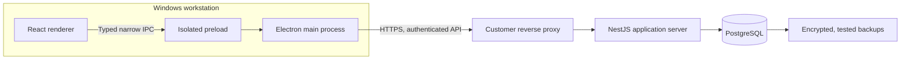

# SMB ERP Desktop — Technical Requirements Document

**Status:** Draft for engineering, operations, security, accounting and product review  
**Version:** 0.2\
**Date:** 17 November 2026\
**Product requirements:** [SMB ERP Desktop PRD](SMB_ERP_DESKTOP_PRD.md)  
**Other inputs:** `ERP_Architecture.md`, `SMB_ERP_PRD.md` and the repository documentation.

This document translates the product requirements into verifiable technical requirements. The source documents are reference material; their original browser/Python architecture is superseded by the agreed stack below. Requirements are proposed until reviewed and do not assert implementation or production readiness. `P0` denotes the first operational release; later work is marked `P1` or `P2+`. Examples are illustrative rather than final API or schema definitions.

## 1. System context and constraints

The product is a Windows-first Electron desktop application using React and TypeScript. Multiple users connect to a customer-operated on-premises NestJS/TypeScript application server backed by PostgreSQL. The server is the authority for authentication, authorisation, business rules, persistence and accounting. Desktop clients communicate with the server API; they never access PostgreSQL directly.

The customer's network, DNS, trusted certificates, server operating system, PostgreSQL and backup infrastructure are deployment dependencies. A vendor internet connection is not a prerequisite for normal on-premises operation. A client must reach its server to transact; offline mutation, synchronisation, mobile and browser clients are not part of the agreed first-release architecture.

Supported OS/database versions, hardware, first tax jurisdiction, deployment topology, authentication integration and mobile requirements are open decisions. PostgreSQL port 5432 and API port 3001 are local development defaults, not mandated production ports.

## 2. Current implementation baseline

Reviewed source baseline: application 0.2.0 / schema 8. The [user guide](USER_GUIDE.md) describes implemented workflows; the [module roadmap](ERP_MODULE_ROADMAP.md) defines proposed expansion. This review does not verify an installed database.

| Area | Existing baseline | Still required for production ERP |
| --- | --- | --- |
| Desktop | Sandboxed/context-isolated renderer, constrained preload/main-process API, Customers, Purchasing, Accounting & stock, Orders & billing, Operations & privacy and Account security and access. | New module journeys, human accessibility acceptance, compatibility negotiation and release hardening. |
| Server | Mandatory MFA, nine fixed roles, access management, request/payment approval, books/stock/trade/import/privacy services, sessions and authentication throttling. | Configurable scoped policies, complete account recovery, broader abuse controls and proposed modules. |
| Data | PostgreSQL migrations through 7; source-linked stock/ledger/trade, audit/history/retry and limited import/privacy records. | Reviewed module migrations/backfills and financial correction/opening; production role configuration and recovery acceptance. |
| Diagnostics | Structured desktop/server logs and request correlation; error handling. | Operational monitoring, alerting, retention and security acceptance. |
| Delivery | Development commands, Windows NSIS packaging and a CI workflow are defined. | Signed, independently verified release; supported deployment, upgrade and recovery procedures. |

The existing audit trigger is not tamper-proof against a database owner. Current local database setup and unsigned installer are development facilities. This document does not certify that tests or a release have passed.

## 3. Repository and component boundaries

| Component | Present location | Technical responsibility |
| --- | --- | --- |
| Electron main/preload | `apps/desktop/src/main` | Window lifecycle, restricted OS features, authenticated API transport, sender-validated IPC and in-memory session state. |
| React renderer | `apps/desktop/src/renderer` | Accessible presentation, input feedback and state display; no independent authority for permissions or posting. |
| API and domains | `apps/server/src` | HTTP endpoints, authentication, authorisation, domain rules, transactions and persistence. |
| Contracts | `packages/contracts` | Shared, versioned request/response and validation contracts where appropriate. |
| Logging | `packages/logging` | Shared structured logging and sanitisation primitives. |
| Infrastructure and tools | `infra`, `tools`, `scripts` | Development, packaging and deployment support; do not distribute server secrets with the desktop. |

**TR-ARC-01 (P0):** Preserve separation between transport, domain rules and persistence. Add domains for identity, organisation configuration, finance, procurement, inventory and reporting with explicit interfaces and ownership. Domain invariants must not depend on client-side checks.

**TR-ARC-02 (P0):** Define contract compatibility for independently deployed clients and servers. The server must expose its version and supported client range. Unsupported clients receive a clear upgrade instruction before performing writes. A precise negotiation endpoint and support window must be agreed before implementation.

**TR-ARC-03 (P1):** If asynchronous jobs, notifications or integrations are introduced, define delivery, retries, idempotency, operational ownership and data retention. Use an atomic outbox or equivalent where a committed transaction must reliably generate an external event. A queue, cache or object-storage product is not yet selected.

## 4. Desktop client requirements

| ID | Priority | Requirement | Verification |
| --- | --- | --- | --- |
| TR-DESK-01 | P0 | Bundle renderer assets locally; maintain Electron sandboxing, context isolation, disabled renderer Node integration and restrictive production content security policy. Restrict navigation, window creation and external links. | Inspect production window settings and exercise malicious navigation and renderer access tests. |
| TR-DESK-02 | P0 | Expose only named, typed IPC operations through preload. Validate the sender, argument shape and operation in the main process; do not expose generic IPC or unrestricted filesystem, shell or network APIs. | Attempt unrecognised channels, malformed messages and calls from an untrusted origin. |
| TR-DESK-03 | P0 | Keep session tokens in main-process memory; never expose them to renderer storage, URLs or logs. Clear local state at sign-out and expiry; document that offline sign-out cannot instantly revoke the server session. | Inspect renderer, persisted profile and logs; test expiry and reconnect. |
| TR-DESK-04 | P0 | Store only necessary connection preferences locally. Validate server origin and enforce trusted HTTPS for remote endpoints; local loopback HTTP is development-only. Do not bypass certificate validation. | Test valid, untrusted, expired and hostname-mismatched certificates and remote HTTP rejection. |
| TR-DESK-05 | P0 | Represent loading, validation, permission, connectivity and uncertain-write outcomes distinctly. Offer a safe refresh/reconciliation path and do not silently queue financial writes. | Interrupt network before and after server commit; verify correct message and final state. |
| TR-DESK-06 | P0 | Support accessible names, logical focus, keyboard operation and error identification. Target WCAG 2.1 AA where applicable to desktop content. | Keyboard and screen-reader test on each supported Windows configuration; record exceptions. |
| TR-DESK-07 | P0 | Support installation, upgrade and uninstall without removing server data. Production installers must be signed and verified, contain no secrets, and be distributed through a trusted channel. | Inspect and verify installer; install and upgrade on a clean workstation. |

Packaging is currently Windows NSIS and the installer is per-user; final managed-deployment and update requirements must be confirmed with customer IT. No automatic update service is assumed.

## 5. API and server requirements

**TR-API-01 (P0):** Use the versioned API boundary, currently `/api/v1/`. Validate request body, parameters and query types, sizes and allowed values at the server boundary. Recheck domain state and permissions inside the relevant transaction. Reject unknown or malformed input without revealing internals.

**TR-API-02 (P0):** Establish a documented error contract containing a stable error code, safe user-facing message and correlation ID. Distinguish invalid input, unauthenticated access, forbidden action, missing record, conflict, rate limit and transient server failure using appropriate HTTP status codes. Do not return stack traces, credentials or SQL internals.

**TR-API-03 (P0):** Paginate and filter large lists using documented deterministic ordering and bounded page sizes. Reports and exports enforce the same data scope as interactive queries. Define timeouts and cancellation behaviour for long operations.

**TR-API-04 (P0):** Mutating operations susceptible to retries must accept an idempotency key scoped to the authenticated actor and operation. Store the request fingerprint, outcome and business change atomically. Reuse with a different payload must fail as a conflict. Define a retention window that covers supported retry and reconciliation scenarios. Current domain idempotency is a starting point; every new module needs an explicit operation/atomic retry boundary.

**TR-API-05 (P0):** Handle concurrent updates with an explicit version or equivalent database locking strategy. A stale write returns a conflict and requires refresh or deliberate resolution. Transactions that affect financial records either commit all intended changes or none.

**TR-API-06 (P0):** Provide authenticated or access-controlled readiness and liveness checks as appropriate to the deployment. Readiness must reflect required dependencies without exposing credentials or sensitive data. Distinguish application availability from database connectivity.

**TR-API-07 (P1):** Publish an external integration contract only after defining authentication, authorisation, rate limits, versioning, audit, support and deprecation. Do not assume the internal desktop API is automatically a supported public integration API.

## 6. Identity, authorisation and audit

| ID | Priority | Technical requirement |
| --- | --- | --- |
| TR-SEC-01 | P0 | Authenticate named users; use a proven password hashing algorithm with configurable work factor, secure account recovery and session revocation. Support MFA for privileged and other applicable users; select methods and recovery process during design. |
| TR-SEC-02 | P0 | Store only hashed server-side session tokens; expire idle and absolute sessions, revoke sessions on administrative disablement, and prevent session disclosure through logs and errors. Existing 30-minute idle and eight-hour absolute settings require product confirmation. |
| TR-SEC-03 | P0 | Enforce server-side permissions for each action and relevant data scope, including reports and exports. Define a role/permission matrix and deny by default. The present nine fixed roles do not provide configurable policies or future-module scopes. |
| TR-SEC-04 | P0 | Implement approval separation-of-duties checks, including self-approval restrictions and independent payment approvals. Record delegation and authorised exceptions with actor, reason and time. |
| TR-SEC-05 | P0 | Apply authentication throttling and abuse controls appropriate to on-premises deployment. Document limits, lockout/recovery and monitoring; avoid creating an easy permanent account-denial mechanism. |
| TR-SEC-06 | P0 | Audit security events and material business changes with actor, UTC time, action, record, result and correlation reference. Restrict access and protect event integrity with operational controls independent of the normal application role. Do not claim absolute tamper-proofing. |
| TR-SEC-07 | P0 | Protect credentials, service accounts, certificates and keys outside source control and artifacts. Use least-privilege database runtime and separate migration/backup roles; define credential rotation and administrative access. |

Transport from client to proxy must use authenticated TLS. When proxy and application are on separate hosts, protect the proxy-to-application hop with authenticated encryption or an approved equivalent; restrict database access to authorised hosts. The current `TLS_PROXY_CONFIRMED` setting is an acknowledgement, not encryption or proof of proxy configuration.

## 7. Data and transactional requirements

### 7.1 Core data model

The logical model must include organisations/configuration, users/roles, suppliers/customers, items, units, warehouses, requests, orders, receipts, supplier invoices, payments, accounts, journals, bank transactions, approvals and audit events. Define keys, ownership, constraints, state transitions and retention for each entity in a reviewed schema design. Later modules add sales, HR, manufacturing and other entities when scoped.

**TR-DATA-01 (P0):** Use PostgreSQL constraints and transactions to enforce referential integrity, uniqueness and valid state alongside domain validation. Generate stable record identifiers and retain references between source documents, approvals, stock movements and journals.

**TR-DATA-02 (P0):** Use exact decimal or integer minor-unit representations for money and explicit precision/rounding rules; never use binary floating-point arithmetic for authoritative financial calculations. Define currency, tax, quantity and unit precision per field. Store timestamps in UTC and retain business-effective dates separately where needed.

**TR-DATA-03 (P0):** Every posted journal must balance by the approved accounting rules; prevent changes to posted transactions except through traceable reversal or authorised adjustment. Prevent unauthorised posting to closed periods. Record source transaction and posting rule version.

**TR-DATA-04 (P0):** Commit stock movement, valuation, applicable ledger postings, approval state and audit data atomically where they are part of one business event. Where a workflow spans transactions, define consistent intermediate states and reconciliation/retry mechanisms.

**TR-DATA-05 (P0):** Use versioned, repeatable, ordered migrations, executed by a separately privileged operator or deployment process. Detect incompatible database versions; back up before production migrations. Document forward repair and backup restoration when rollback cannot safely reverse a migration.

**TR-DATA-06 (P0):** Import through validated staging or an equivalent controlled process. Produce row-level failures and reconciliation totals; prevent partially committed financial batches from appearing complete. Restrict and protect import/export files.

### 7.2 P2P invariants

- A request or order has a defined state machine and approval history; transitions check actor, business rules, document version and configured thresholds.
- Receipts reference order lines and warehouse locations. Partial, short and damaged quantities remain distinguishable. Concurrent receipts cannot silently exceed the permitted quantity.
- Invoice matching compares supplier, order, receipts, quantities and prices against versioned tolerances. Duplicate invoice identifiers are checked under an agreed supplier/jurisdiction policy, with an auditable exception process.
- Payment batches contain eligible open liabilities, enforce independent approval where configured and prevent duplicate allocation/payment recording under retries and concurrent submissions.
- Quantity, inventory valuation, receipt clearing, payable and payment postings reconcile to their source records using a jurisdiction-specific, accountant-approved posting matrix. No specific debit/credit mapping is assumed until that review.

## 8. Privacy, security and operational controls

**TR-PRV-01 (P0):** Catalogue personal fields and processing purposes, data flows, recipients, access roles and retention periods with the controller. Limit collected and displayed data to the intended purpose, including reports, exports, diagnostics and non-production datasets.

**TR-PRV-02 (P0):** Provide authorised discovery and export of applicable personal records; support correction, restriction and controlled deletion/anonymisation where appropriate. Record request decisions and exceptions. Retention and erasure must account for statutory financial records and backup lifecycle; erasure is not automatically applicable in every case.

**TR-PRV-03 (P0):** Encrypt production data and backups at rest using a documented deployment configuration; establish key custody, access, rotation, recovery and destruction responsibilities. Specify controls for restored backups and support access. Encryption alone does not establish GDPR compliance.

**TR-OPS-01 (P0):** Emit structured, sanitised logs with timestamp, component, event, severity and correlation ID. Do not log passwords, tokens, database URLs, unrestricted request bodies or unnecessary personal data. Restrict access and set retention/rotation and monitoring policies. Business audit records are separate from diagnostic logs.

**TR-OPS-02 (P0):** Monitor service availability, database health, storage capacity, backup success, restore tests and relevant security events. Provide an actionable alert routing and incident procedure. Set thresholds and ownership with the customer.

**TR-OPS-03 (P0):** Automate or provide an operable scheduled backup process covering the database and any necessary configuration or file data. Encrypt backups, monitor failures, test restoration into an isolated environment and document recovery point/time objectives and retention. Objectives are customer-specific and must be measured.

**TR-OPS-04 (P0):** Document customer and vendor responsibilities for server maintenance, patches, network and certificates, account management, breach response and data-subject requests. Review the data protection implications with qualified advisers. See the [European Commission's data-protection obligations guidance](https://commission.europa.eu/law/law-topic/data-protection/information-business-and-organisations/obligations_en) and the [EDPB small-business FAQ](https://www.edpb.europa.eu/sme/find-practical-info/faq_en).

## 9. Performance, availability and capacity

The following are inherited **proposed** acceptance targets, not measurements or guaranteed service levels. Define server/workstation specifications, data set, network latency, concurrency profile, warm-up, exclusions and sampling before testing.

| ID | Target | Verification |
| --- | --- | --- |
| TR-NFR-01 | 50 concurrent users on a representative workload. | Load test mixed reads and writes; report contention, error rate and resource utilisation. |
| TR-NFR-02 | Common screen response P95 under 2 seconds. | Measure user-observed navigation on the supported workstation and network. |
| TR-NFR-03 | Routine API response P95 under 500 ms. | Measure representative server operations; identify excluded long jobs. |
| TR-NFR-04 | Standard financial statements complete within 30 seconds. | Test agreed reports and representative data volume. |
| TR-NFR-05 | 99.5% availability during agreed business hours. | Define measurement window, planned maintenance and server/network responsibilities. |

Do not satisfy these targets by disabling access checks, sacrificing accounting consistency or excluding failures from measurements without an agreed test protocol.

## 10. Build, release and deployment

**TR-REL-01 (P0):** Build from a locked dependency graph in a clean environment; record source revision, version, dependencies, test results and artifact checksums. Maintain an SBOM, vulnerability review and dependency update policy. Verify that secrets, databases, server code and development-only files are absent from the desktop installer.

**TR-REL-02 (P0):** CI must check types, relevant unit/integration tests and Windows packaging. Test the packaged desktop in Windows; run database integration tests against an isolated PostgreSQL instance. A workflow definition is not evidence of a successful remote run.

**TR-REL-03 (P0):** Sign release installers with a protected code-signing identity; verify signature and checksum independently. Release credentials are supplied through protected deployment facilities and never committed. Establish approval, artifact retention and distribution policy. No automatic publication is assumed.

**TR-REL-04 (P0):** Provide repeatable server installation and configuration, service management, least-privilege accounts, TLS proxy, migration, monitoring and backup procedures. Define compatibility across client, server and database versions, with a tested upgrade and recovery plan.

**TR-REL-05 (P0):** Separate development, staging and production configuration and data. A desktop installation must not contain a server `.env`, database password, signing key or production private certificate. Use synthetic or suitably protected test data.

### Existing development commands

Run from the repository root; see [development documentation](DEVELOPMENT.md) for prerequisites and details.

| Command | Intended use |
| --- | --- |
| `npm ci` | Install dependencies from the lockfile. |
| `npm run setup` | Initialise development environment and database setup. |
| `npm run dev` | Run development server and desktop watchers. |
| `npm run check` / `npm test` | Type checking and non-integration tests. |
| `npm run test:integration` | Server/PostgreSQL integration tests using an isolated schema. |
| `npm run test:desktop` | Electron desktop smoke tests. |
| `npm run package:windows` / `npm run test:packaged` | Build the Windows installer and test the packaged desktop. |

These are repository commands, not evidence that they were run while drafting this document. See [Windows installer](WINDOWS_INSTALLER.md), [deployment](DEPLOYMENT.md), and [PostgreSQL setup](POSTGRES_SETUP.md) for current operating procedures.

## 11. Verification and release acceptance

| Test area | Minimum evidence for phase 1 |
| --- | --- |
| Unit and contract | Domain calculations, validation, permission decisions, state transitions, error contract and idempotency fingerprint conflicts. |
| Database integration | Concurrent updates, duplicate requests, transaction rollback, migrations, database constraints, audit and source-to-ledger reconciliation. |
| End-to-end | Two distinct client roles complete and reconcile request → order → partial receipt → match/exception → payment and ledger; forbidden actions are rejected server-side. |
| Security | Threat model and review; IPC boundary, server permissions, certificate failures, session revocation, secret leakage and dependency findings. |
| Recovery | Restore a representative backup in isolation, verify integrity and reconciled records, and measure against agreed recovery objectives. Test supported upgrades and documented recovery. |
| Desktop accessibility | Keyboard and screen-reader walkthroughs of core workflows, including validation and error states, on supported Windows configurations. |
| Performance | Measured results and environment against section 9, including concurrent users and representative data. |
| Privacy and operations | Approved data inventory, retention and request procedures, encryption/key ownership, support access, monitoring and incident responsibilities. |
| Accounting and localisation | Accountant-approved posting matrix, country-specific tax configuration, migration totals, period close and reconciled financial statements. |
| Distribution | Clean-machine installation, signature verification, client/server compatibility, upgrade and uninstall; release artifact scan. |

Critical financial, security, recovery or data-integrity failures block release. Assign ownership and resolution criteria to lesser findings; do not label a build production-ready solely because it packages successfully.

## 12. Implementation sequence and dependencies

Steps 1–6 retain the foundation target sequence; many business slices already exist as identified in section 2. Use PIL/FUP evidence to close remaining gaps rather than reimplementing delivered foundations. Step 7 gives the proposed expansion order.

1. Agree supported environment, pilot customer, jurisdiction, accounting and stock policies; define the role matrix and transaction/posting specifications.
2. Harden identity, user administration, MFA, permissions, audit, logging and the client/server compatibility contract; establish tested backup and recovery.
3. Implement supplier and item masters, purchase requests and approvals; validate state transitions and concurrent access.
4. Add purchase orders, receiving and inventory valuation with atomic source/audit/posting records and reconciliation.
5. Add supplier invoices, three-way matching, accounts payable, payment controls, bank reconciliation, period close and essential reports.
6. Complete migration rehearsal, privacy and security review, performance/accessibility testing, signed distribution and pilot acceptance before production.
7. Follow the [module roadmap](ERP_MODULE_ROADMAP.md): core/Finance completion → CRM → Sales with basic stock fulfilment → Supply Chain expansion → HR core/expenses → Marketing. Payroll, manufacturing, projects, assets and country packs require separate scope. Existing pilot capacity is unchanged.

## 13. Open technical decisions

| Decision | Dependency or consequence |
| --- | --- |
| First jurisdiction, currency, tax and retention rules | Posting matrix, statutory reporting, data retention and production acceptance. |
| Supported Windows, server OS, Node.js and PostgreSQL versions | Build matrix, installer support, patching and deployment documentation. |
| User directory, MFA factors and account recovery | Identity implementation and customer IT operations. |
| Reverse proxy, certificates, DNS, remote access and network topology | Trust, deployment instructions and capacity/security testing. |
| Backup tooling, storage, encryption/key ownership, RPO/RTO | Recovery architecture and measurable operational commitment. |
| Inventory costing, negative stock, tax/rounding and currency precision | Schema, calculation rules, transaction concurrency and accounting validation. |
| Desktop update and signing infrastructure | Release distribution, offline deployments and trust. |
| Mobile approvals and warehouse access | Whether an additional client and threat model are needed. |
| Document attachments, background jobs, external integrations | Storage, transactional delivery, retention and operational support design. |

## 14. Requirements traceability

| Product requirement | Technical requirements |
| --- | --- |
| `FR-DESK-01`–`07` | TR-DESK-01–07, TR-ARC-02, TR-REL-03–04 |
| `FR-PLT-01`–`07` | TR-SEC-01–07, TR-API-06, TR-OPS-01–04 |
| `FR-FIN-01`–`08` | TR-DATA-01–06, TR-API-04–05, section 11 accounting acceptance |
| `FR-P2P-01`–`06` | TR-API-04–05, TR-SEC-03–04, TR-DATA-01–04 and section 7.2 |
| `FR-INV-01`–`04` | TR-DATA-01–04, section 7.2 and section 11 reconciliation tests |
| `FR-RPT-01`–`03`, `FR-INT-01`–`03` | TR-API-03 and 07, TR-ARC-03, TR-DATA-06, TR-PRV-01 |
| PRD security, accessibility, privacy and operations | TR-DESK-01–07, TR-SEC-01–07, TR-PRV-01–03, TR-OPS-01–04, TR-NFR-01–05 |
| FR-CRM-01/02, FR-SLS-06, FR-SCM-01–03, FR-HR-05, FR-MKT-01–03, FR-FIN-09/10 | Section 15 and module roadmap epics; detailed contracts and module acceptance required before implementation. |

## 15. Proposed module engineering requirements

Reviewed 17 November 2026. These extend the implemented schema 7 baseline and remain design requirements; no new service, permission, endpoint or dependency is introduced by this document.

| ID | Requirement | Verification required for the module release |
| --- | --- | --- |
| TR-MOD-01 | Keep cohesive CRM, Sales, HR and Marketing domain boundaries in the NestJS application and extend existing Finance/procurement/inventory services. Shared parties/items, one stock ledger and one GL remain authoritative; cross-domain writes use reviewed application interfaces. | Review ownership and typed contracts/IPC; reject calls that bypass posting/permission boundaries. No new microservice infrastructure is assumed. |
| TR-MOD-02 | Preserve current customer codes, existing IDs and immutable source references through additive migrations/backfills. Store prospect conversion and contact links explicitly; employee identity is distinct from user identity. | Upgrade a populated schema 7 copy; counts/references/permissions and financial balances agree; duplicate concurrent conversions return one customer link. |
| TR-MOD-03 | Define reservation availability and lock order. Reserve/release without moving on-hand; dispatch consumes eligible stock and commitments, posts valuation/COGS once and creates source allocations. Retain the company financial lock until measured redesign is justified. | Concurrent reservation/dispatch/cancel/return and interrupted-response tests; no oversell, duplicate cost, invoice over-allocation or control-account difference. |
| TR-MOD-04 | Extend server action/record/field/export rules for Sales teams, warehouse scope, own/manager/HR access and Marketing audiences. Existing single fixed-role assignments cannot be silently interpreted as composable roles. | Direct API/search/report/history/export denials, reassignment/offboarding tests and least-privilege migration review. |
| TR-MOD-05 | Specify complete state/version/correction rules for orders, sourcing, stock exceptions, leave, claims and campaigns. Finance owns new credits/refunds and employee-payable source posting. | Independent expected-result fixtures; denied self-approval, closed-period and over-allocation tests; no partial state/audit/ledger commits. |
| TR-MOD-06 | Add new personal entities to import validation, discovery, holds, retention, export and recovery replay. Define attachment limits/type validation, access and protected storage/backup before enabling uploads. | Invalid batch rollback, scoped disclosure, secret-free logs and an isolated restore covering selected files and post-backup restrictions. |
| TR-MOD-07 | If delivery/integrations are selected, persist committed delivery intent with an outbox or equivalent, deduplicate provider events, recheck eligibility at dispatch and bound retry/dead-letter processing. Keep jobs paused during restore. | Failure before/after provider acknowledgement, duplicate/reordered callbacks, unsubscribe before send, restart and restore tests; uncertain provider outcomes require reconciliation. |
| TR-MOD-08 | Define metric formula, period/timezone, data source and freshness for pipeline, availability, budget and campaign attribution. Separate opportunity value, booked orders, posted net revenue and collected cash. | Recompute from synthetic source records; deduplicate conversion; enforce aggregate and drill-through visibility; benchmark changed mixed workloads. |
| TR-MOD-09 | Record client/server/contracts/schema/module scope per release and block incompatible writes. New module tables require reviewed future migrations rather than an assumed schema number or plugin installer. | Compatibility, populated-database upgrade, signed installer and rollback/new-database recovery evidence; module-specific operator/user guide updates and docs check. |

Trace proposed entities in [schema section 15](SMB_ERP_BACKEND_SCHEMA.md#15-proposed-module-extensions), access in [security section 12](SMB_ERP_SECURITY_AND_ACCESS.md#12-proposed-module-access-boundaries) and release scenarios in [testing section 12](SMB_ERP_TESTING_DEPLOYMENT_RUNBOOK.md#12-module-expansion-acceptance). Scheduling and acceptance remain future work.
